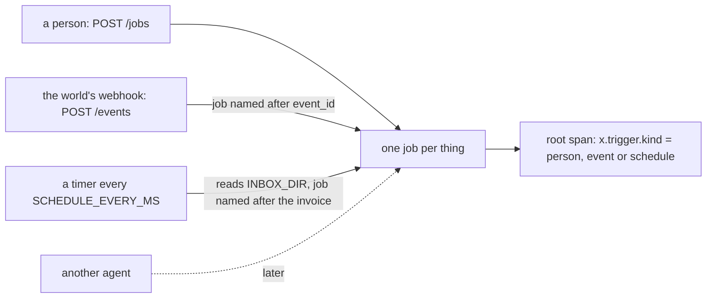

# Start on an event and a schedule

## The problem

Ravi does not want to type a job for every invoice. Some carriers upload invoices to a portal, and the portal sends
a webhook. A webhook is an HTTP call another system makes to you when something happens. Other carriers email their
invoices. Those land in a mailbox, and a timer reads it.

That gives two new ways to start a job, and two new ways to pay twice:

- A webhook is sent "at least once". So the same event can arrive twice.
- A timer that starts a job for every file it sees starts the same invoice again on the next tick.

For example, the world sends `{"event_id": "evt-...", "type": "invoice.received", "tenant": "kaas-freight",
"invoice_id": "INV-2041"}`. INV-2041 is a clean invoice for USD 1,910. If the same `event_id` arrives twice, your
employee must start one job and pay USD 1,910 once.

## Your challenge

1. Add `"event"` and `"schedule"` to `starts_by` in the `[hire]` block of `employee.toml`.
2. Add `POST /events`. The world sends `{"event_id", "type": "invoice.received", "tenant", "invoice_id"}`.
   - Start a job named after the `event_id`, and answer `202`.
   - When the same `event_id` comes again, answer `200` and start nothing new.
3. Add a timer. It runs every `SCHEDULE_EVERY_MS` milliseconds. The checker sets this short.
   - Each time, read each `*.json` file in `INBOX_DIR`. A file holds `{"tenant", "invoice_id"}`.
   - Start a job named after the tenant and the invoice. Then the next tick finds that job and starts nothing.
4. Put the trigger kind in `x.trigger.kind` on each run's root `invoke_agent` span.



## Done when

- `employee.toml` says `starts_by = ["person", "event", "schedule"]`.
- A webhook sent twice pays its invoice once, with one job in the world's access log.
- An inbox file pays its invoice once over many ticks, with one job in the access log.
- The root span says `event` or `schedule` for each.

```bash
bun run verify start-on-an-event-and-a-schedule
```

Expect: `Done. All 2 rules pass.`

## If you get stuck

| What you see                         | Fix                                                               |
| ------------------------------------ | ----------------------------------------------------------------- |
| `POST /events answered 404`          | Add the route next to `POST /jobs`; both start a job the same way |
| `2 jobs on INV-...` from the webhook | Use `event_id` in the job id, never a fresh random id             |
| `jobs on INV-...` from the timer     | The job id must not include the tick count or the time            |
| `says x.trigger.kind = "person"`     | Pass the trigger into the job and copy it onto the root span      |

## Words you will use

- **Webhook**: an HTTP call another system makes to you when something happens.
- **At least once**: a promise that a message is never lost, but it may come more than once.
- **Trigger**: what started a job: a person, an event, a schedule or another agent.
- **Tick**: one run of the timer.
