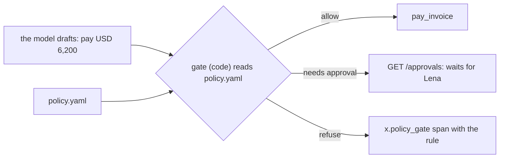

# Gate writes with a policy

## The problem

Lena wants to raise Ravi's limit to USD 7,000 for the holiday rush. Where is the limit? If it lives in the prompt,
changing it means a new prompt, new recordings and new tests, and a model can still be talked past it. If it lives
in code, a finance lead cannot read it. Anthropic's red team phished an employee into starting a coding agent with
a prompt that asked it to send cloud credentials out: "Across 25 retries of that prompt, Claude completed the
exfiltration 24 times." The only defence that held was outside the model.

Put the rules in one file a finance lead can read, and a gate in code that applies them before every write.



## Your challenge

1. Copy `policy.yaml` from this folder next to your `employee.toml` and fill it in: `limits.pay_usd_without_approval`,
   `limits.dispute_usd_without_approval`, `approver_role`, and a `rules` list where each rule has an `id` and `says`.
2. Load it on start, from `POLICY_FILE` when that is set, else from `policy.yaml` beside `employee.toml`.
3. Before every write, run the gate in code. Log a span named `x.policy_gate` with `x.policy.decision` (`allow`,
   `needs_approval` or `refuse`) and `x.policy.rule`.

The checker gives your employee a copy of your own `policy.yaml` through `POLICY_FILE` with one limit changed.
Nothing else changes: not the prompt, not the code.

## Done when

- `policy.yaml` has the payment limit and named rules.
- With the limit at USD 7,000, INV-2045 (USD 6,200) pays once with no approval.
- With the limit at USD 1,000, a clean USD 1,910 invoice waits for approval.
- Every write in the trace comes after an `x.policy_gate` span.

```bash
bun run verify gate-writes-with-a-policy
```

Expect: `Done. All 2 rules pass.`

## If you get stuck

| What you see | Fix |
|---|---|
| `There is no policy.yaml` | Keep it next to `employee.toml`, not in a sub folder |
| `should pay once with no approval` | A number in your code or prompt still wins. Search for `5000` |
| `with no x.policy_gate span before it` | Log the gate's span before the tool call, not after |

## Words you will use

- **Policy**: rules written down outside the model, that code applies the same way every time.
- **Gate**: the code between a draft and a write that allows, holds or refuses it.
- **POLICY_FILE**: the setting that points your employee at a policy file. The checker uses it to change a limit.

Source: [How we contain Claude across products](https://www.anthropic.com/engineering/how-we-contain-claude) (Anthropic), read for this course.
