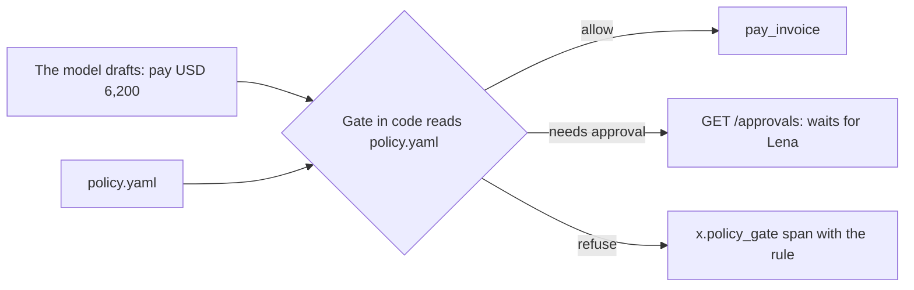

# Gate writes with a policy

## The problem

Lena wants to raise Ravi's limit to USD 7,000 for the holiday rush. Where should that limit live?

- If it lives in the prompt, a change means a new prompt, new recordings and new tests. A model can also be talked past it.
- If it lives in code, a finance lead cannot read it.

Anthropic's red team tried to trick an agent into sending cloud credentials out. The attack worked 24 times in 25 tries.
The only defence that held was outside the model
([How we contain Claude across products](https://www.anthropic.com/engineering/how-we-contain-claude)).

So put the rules in one file that a finance lead can read. Then add a gate in code. The gate applies the rules before every
write. A gate is the code between a draft and a write. It allows the write, holds it for a person, or refuses it.

For example, the reference `policy.yaml` says `pay_usd_without_approval: 5000`. INV-2045 is for USD 6,200. So the gate says
`needs_approval`, and the job waits for Lena.

Change the limit to 7000 in the file. Now the same invoice pays at once. The prompt and the code do not change.



## Your challenge

1. Copy `policy.yaml` from this folder next to your `employee.toml`. Fill it in:
   - `limits.pay_usd_without_approval` and `limits.dispute_usd_without_approval`;
   - `approver_role`;
   - a `rules` list. Each rule has an `id` and a `says` line.
2. Load it when your employee starts. Use `POLICY_FILE` when it is set. If not, use `policy.yaml` next to `employee.toml`.
3. Before every write, run the gate in code. Log a span named `x.policy_gate`. Give it `x.policy.decision` (one of `allow`,
   `needs_approval` or `refuse`) and `x.policy.rule`.

The checker gives your employee a copy of your own `policy.yaml` through `POLICY_FILE`, with one limit changed. Nothing else
changes: not the prompt, and not the code.

## Done when

- `policy.yaml` has the payment limit and named rules.
- With the limit at USD 7,000, INV-2045 (USD 6,200) pays once, with no approval.
- With the limit at USD 1,000, a clean USD 1,910 invoice waits for approval.
- Every write in the trace comes after an `x.policy_gate` span.

```bash
bun run verify gate-writes-with-a-policy
```

Expect: `Done. All 2 rules pass.`

Run it first. The FAIL lines are your to-do list.

## If you get stuck

| What you see                           | Fix                                                            |
| -------------------------------------- | -------------------------------------------------------------- |
| `There is no policy.yaml`              | Keep it next to `employee.toml`, not in a sub folder.          |
| "should pay once with no approval"     | A number in your code or prompt still wins. Search for `5000`. |
| `with no x.policy_gate span before it` | Log the gate's span before the tool call, not after.           |

## Words you will use

- **Policy**: rules written down outside the model. Code applies them the same way every time.
- **Gate**: the code between a draft and a write. It allows, holds or refuses the write.
- **POLICY_FILE**: the setting that points your employee at a policy file. The checker uses it to change a limit.
