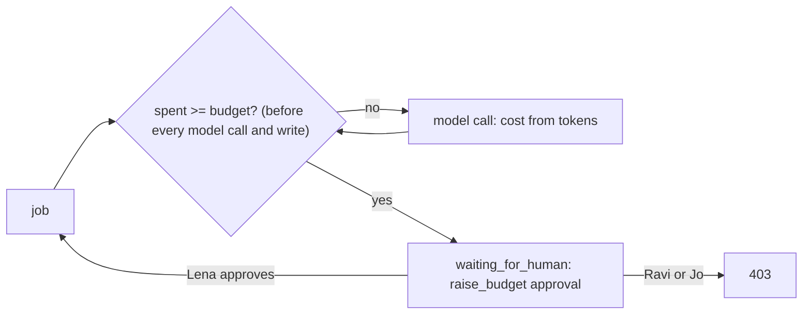

# Cap the spend

## The problem

One job loops. It asks the model again and again and never writes. Nobody notices until the bill comes. A budget
that is only a number in `employee.toml` is a wish.

A cap is code that does three things:

- it stops a job before its next model call, once the budget is spent;
- it puts the job in front of a person;
- it lets only the finance lead raise the budget.

For example, the reference sets `max_usd_per_job = 0.05` and `max_usd_per_day = 5` in `employee.toml`. The checker
lowers the job budget to USD 0.00001, less than one model call costs. Now a clean invoice is not paid. Its job
waits in Needs you with a `raise_budget` approval. Ravi and Jo get `403`. When Lena approves, the invoice is paid
once.

## Your challenge

1. Read `max_usd_per_job` and `max_usd_per_day` from `[budget]` in `employee.toml`. An operator can lower them with
   `BUDGET_USD_PER_JOB` and `BUDGET_USD_PER_DAY`. The checker does that.
2. Work out the cost of each model call from its token counts. Use the dated prices in `config/models.ts`.
3. Check the spend before every model call and before the write. Stop the job in two cases:
   - its own spend reached its budget;
   - the spend across all jobs reached `max_usd_per_day`.
4. A stopped job goes to `waiting_for_human`. Its approval has `action` set to `raise_budget`. Its `approver_role`
   is the finance lead.
5. Only the finance lead may approve `raise_budget`. Ravi and Jo get `403`. Lena's approval raises the cap, and
   the job carries on.



## Done when

- With a tiny job budget, a clean invoice is not paid and its job waits. The traces show at most one call past the
  budget.
- Jo and Ravi get `403` on `raise_budget`. After Lena approves, the invoice is paid once.
- With a tiny cap across jobs, five jobs spend at most one call past it, and a job waits.

```bash
bun run verify cap-the-spend
```

Expect: `Done. All 2 rules pass.`


## If you get stuck

| What you see                             | Fix                                                               |
| ---------------------------------------- | ----------------------------------------------------------------- |
| `the ledger shows INV-... paid`          | Check the budget after the model call too, before the write       |
| `no "raise_budget" approval`             | Add the approval when you stop, with `action: "raise_budget"`     |
| `Ravi Shah (AP clerk) raised the budget` | Check the person's role, not their payment limit                  |
| `more than one model call past the cap`  | Add up `spend` across every job in `STATE_DIR`, not only this one |

## Words you will use

- **Budget**: the most one job may spend on model calls.
- **Cap across jobs**: the most all jobs together may spend before every job waits.
- **Cost alarm**: the Needs you card that tells a person the money stopped the job.
