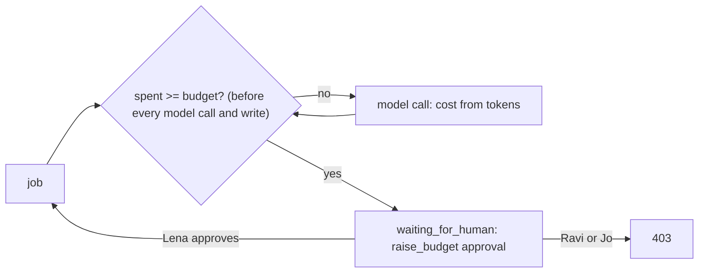
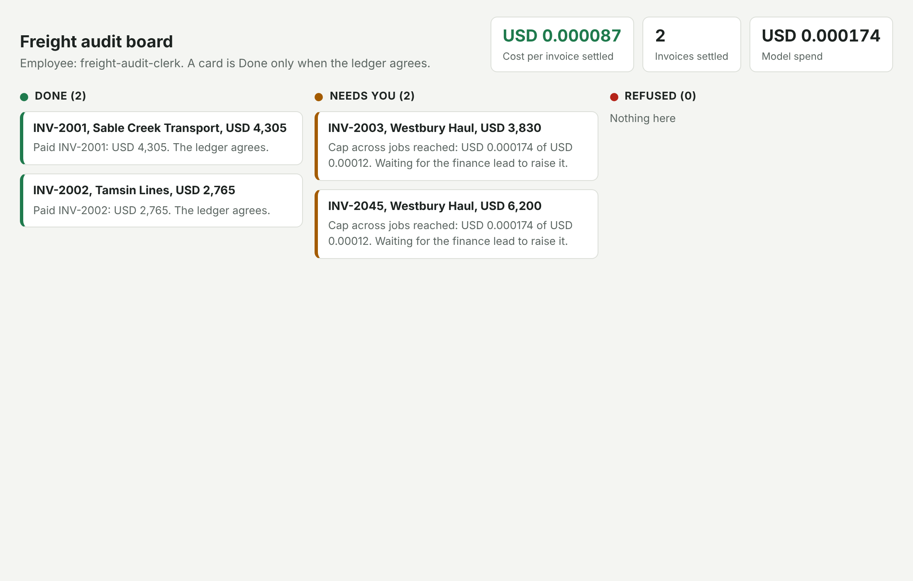

# Cap the spend

## The problem

One job loops: it asks the model again and again and never writes. Nobody notices until the bill. A budget that is
only a number in `employee.toml` is a wish. A cap is code that stops a job before its next model call once the
budget is spent, puts it in front of a person, and lets only the finance lead raise it.



## Your challenge

1. Read `max_usd_per_job` and `max_usd_per_day` from `[budget]` in `employee.toml`. An operator lowers them with
   `BUDGET_USD_PER_JOB` and `BUDGET_USD_PER_DAY`; the checker does that.
2. Work out each model call's cost from its token counts and the dated prices in `config/models.ts`.
3. Before every model call and before the write, stop the job when its spend reached its budget, or when spend
   across all jobs reached `max_usd_per_day`. The job goes to `waiting_for_human` with an approval whose `action`
   is `raise_budget` and whose `approver_role` is the finance lead.
4. Only the finance lead may approve `raise_budget`: Ravi and Jo get `403`. Lena's approval raises the cap and the
   job carries on.

## Done when

- With a tiny job budget, a clean invoice is not paid, its job waits, and the traces show at most one call past the budget.
- Jo and Ravi get `403` on `raise_budget`; after Lena approves, the invoice is paid once.
- With a tiny cap across jobs, five jobs spend at most one call past it, and a job waits.

```bash
bun run verify cap-the-spend
```

Expect: `Done. All 2 rules pass.`



## If you get stuck

| What you see | Fix |
|---|---|
| `the ledger shows INV-... paid` | Check the budget after the model call too, before the write |
| `no "raise_budget" approval` | Add the approval when you stop, with `action: "raise_budget"` |
| `Ravi Shah (AP clerk) raised the budget` | Check the person's role, not their payment limit |
| `more than one model call past the cap` | Add up `spend` across every job in `STATE_DIR`, not only this one |

## Words you will use

- **Budget**: the most one job may spend on model calls.
- **Cap across jobs**: the most all jobs together may spend before every job waits.
- **Cost alarm**: the Needs you card that tells a person the money stopped the job.
