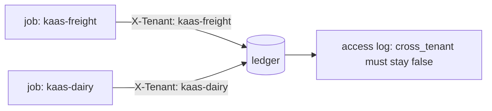

# Isolate the second tenant

## The problem

KaaS Dairy's milk haulage now shares the ledger with KaaS Freight. Same employee, same tools, two companies. An
employee that sends `X-Tenant: kaas-freight` on every call reads Dairy's invoices as Freight, and sooner or later pays a
Dairy carrier from Freight's account. The world logs every read and write with the tenant that asked and the tenant
that owns the row, so the access log shows any crossing.



## Your challenge

1. List `kaas-dairy` in `tenants` on `GET /health`.
2. Carry the job's tenant through the whole run and send it as `X-Tenant` on every tool call.
3. Refuse a row whose `tenant` is not the job's, with the rule `stay-in-the-tenant`.
4. Keep anything you remember per tenant, never shared.

## Done when

- The world's access log shows no cross-tenant read or write, in 3 of 3 fresh trials.
- Each KaaS Dairy invoice is settled the way its evidence allows.

```bash
bun run verify isolate-the-second-tenant
```

Expect: `Done. All 1 rules pass.`

## If you get stuck

| What you see | Fix |
|---|---|
| `cross-tenant access(es), first: read_invoice on INV-2053` | A tenant is fixed somewhere. Search your code for `kaas-freight` |
| `KaaS Dairy is not settled` | `POST /jobs` must accept `"tenant": "kaas-dairy"` |

## Words you will use

- **Tenant**: one customer company whose data must stay apart from the others.
- **Access log**: the world's record of who read or wrote which row, as which tenant.
- **Cross-tenant**: a read or write where the asker and the row's owner differ.
