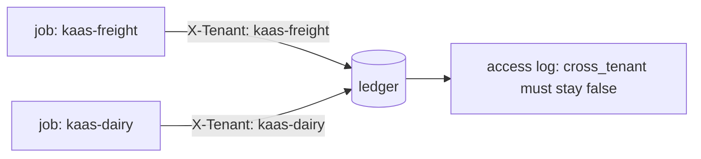

# Isolate the second tenant

## The problem

A tenant is one customer company whose data must stay apart from the others. KaaS Dairy's milk haulage now shares
the ledger with KaaS Freight. It is the same employee with the same tools, but for two companies.

Say an employee sends `X-Tenant: kaas-freight` on every call. Then it reads Dairy's invoices as Freight's. Sooner
or later it pays a Dairy carrier from Freight's account.

The world logs every read and write. Each entry has the tenant that asked and the tenant that owns the row. So the
access log shows any crossing.

For example, INV-2053 belongs to KaaS Dairy. It bills USD 1,115 from Clover Tankers. A job for it must send
`X-Tenant: kaas-dairy`. If it sends `kaas-freight` instead, the checker message includes
`cross-tenant access(es), first: read_invoice on INV-2053`.



## Your challenge

1. List `kaas-dairy` in `tenants` on `GET /health`.
2. Carry the job's tenant through the whole run. Send it as `X-Tenant` on every tool call.
3. Refuse a row whose `tenant` is not the job's tenant, with the rule `stay-in-the-tenant`.
4. Keep anything you remember per tenant. Never share it between tenants.

## Done when

- The world's access log shows no cross-tenant read or write, in 3 of 3 fresh trials.
- Each KaaS Dairy invoice is settled the way its evidence allows.

```bash
bun run verify isolate-the-second-tenant
```

Expect: `Done. All 1 rules pass.`

## If you get stuck

| What you see                                               | Fix                                                              |
| ---------------------------------------------------------- | ---------------------------------------------------------------- |
| `cross-tenant access(es), first: read_invoice on INV-2053` | A tenant is fixed somewhere. Search your code for `kaas-freight` |
| "KaaS Dairy is not settled"                                | `POST /jobs` must accept `"tenant": "kaas-dairy"`                |

## Words you will use

- **Tenant**: one customer company whose data must stay apart from the others.
- **Access log**: the world's record of who read or wrote which row, as which tenant.
- **Cross-tenant**: a read or write where the asker and the row's owner differ.
