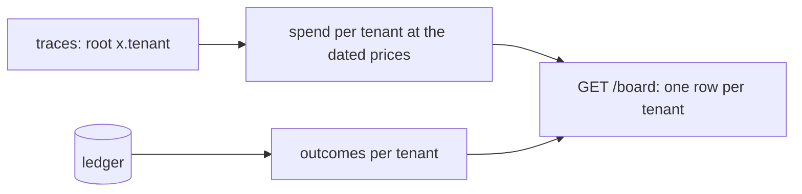
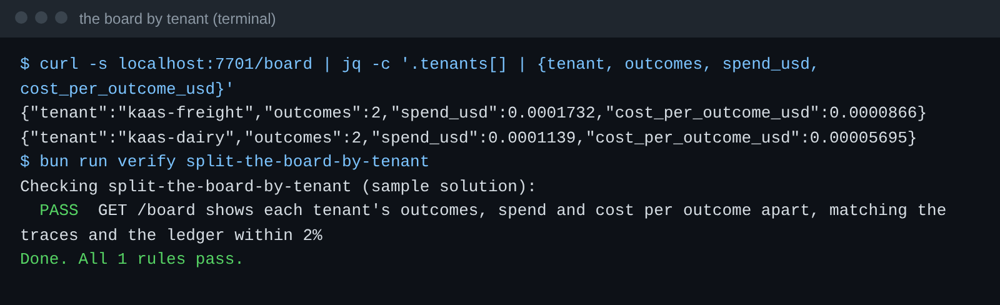

# Split the board by tenant

## The problem

Finance asks what KaaS Dairy costs. The board shows one number for everyone, so nobody can say. Worse, Dairy's
failed runs hide inside Freight's cost per invoice.

Each tenant needs its own three numbers: outcomes, spend, and cost per outcome. An outcome is an invoice that the
ledger shows settled the right way. Those numbers must match the traces, not a counter the employee keeps for
itself.

For example, the checker settles some KaaS Freight invoices and some KaaS Dairy invoices, such as INV-2053.
`GET /board` must then show one row for `kaas-freight` and one for `kaas-dairy`. Say the ledger shows 2 Dairy
invoices settled. Then the Dairy row must say 2 outcomes, not 4. Its spend must match the cost of Dairy's model
calls in the traces.



## Your challenge

Group `GET /board` by each job's tenant. Put one entry in `tenants` for each tenant. Give each entry `outcomes`,
`spend_usd` and `cost_per_outcome_usd`.

Count the spend of every run, failed and waiting runs too. Put `x.tenant` on every root span. Then the checker can
add up the same numbers from your traces.

## Done when

- `GET /board` has a row for `kaas-freight` and one for `kaas-dairy`.
- Each row's outcomes match the ledger. Its spend and cost per outcome match the traces within 2%.

```bash
bun run verify split-the-board-by-tenant
```

Expect: `Done. All 1 rules pass.`



## If you get stuck

| What you see                           | Fix                                                           |
| -------------------------------------- | ------------------------------------------------------------- |
| `GET /board has no row for kaas-dairy` | Group by `job.tenant`, not by a fixed name                    |
| `has 4 outcomes; the ledger shows 2`   | Count only jobs whose ledger rows agree, per tenant           |
| `spent USD ...; the traces ... cost`   | Count spend of every run, including ones waiting for a person |

## Words you will use

- **Cost per outcome**: spend divided by the outcomes the ledger agrees with.
- **Dated price table**: prices in `config/models.ts`, with the date they were read. The checker refuses a table
  that is too old.
