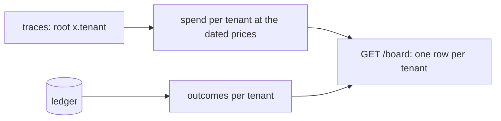

# Split the board by tenant

## The problem

Finance asks what KaaS Dairy costs. The board shows one number for everyone, so nobody can say. Worse, Dairy's
failed runs hide inside Freight's cost per invoice. Each tenant needs its own outcomes, spend and cost per outcome,
and those numbers must match the traces, not a counter the employee keeps for itself.



## Your challenge

Group `GET /board` by each job's tenant: one entry in `tenants` per tenant, each with `outcomes`, `spend_usd` and
`cost_per_outcome_usd`. Count every run's spend, failed and waiting runs too. Put `x.tenant` on every root span so
the checker can add up the same numbers from your traces.

## Done when

- `GET /board` has a row for `kaas-freight` and one for `kaas-dairy`.
- Each row's outcomes match the ledger, and its spend and cost per outcome match the traces within 2%.

```bash
bun run verify split-the-board-by-tenant
```

Expect: `Done. All 1 rules pass.`


## If you get stuck

| What you see | Fix |
|---|---|
| `GET /board has no row for kaas-dairy` | Group by `job.tenant`, not by a fixed name |
| `has 4 outcomes; the ledger shows 2` | Count only jobs whose ledger rows agree, per tenant |
| `spent USD ...; the traces ... cost` | Count spend of every run, including ones waiting for a person |

## Words you will use

- **Cost per outcome**: spend divided by outcomes the ledger agrees with.
- **Dated price table**: prices in `config/models.ts` with the date they were read; the checker refuses one too old.
