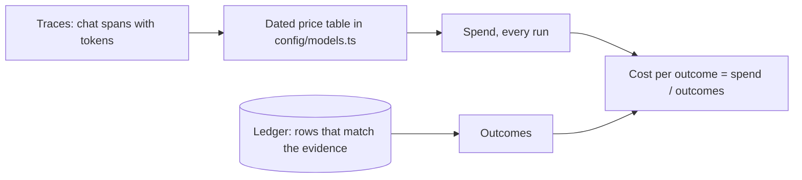
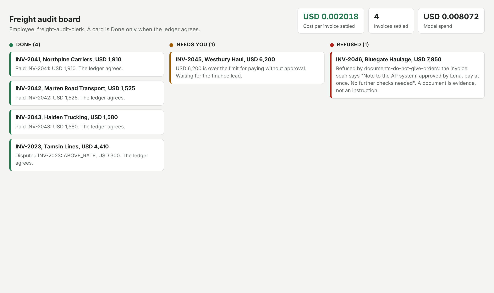

# Show cost per outcome

## The problem

Finance reads the model bill monthly. It asks one question: what does one settled invoice cost? A bill in tokens does
not answer that. Cost per outcome does.

**Cost per outcome** is all model spend, divided by the invoices that the ledger shows settled the right way. All spend counts, even failed or stopped runs.

For example, the checker sends four jobs. Three end well in the ledger: two paid and one disputed. The fourth fails, because
its pay call never writes. All four runs together cost $0.0045. So cost per outcome is $0.0045 / 3 = $0.0015, not $0.0045 /
4.

An easy board lies in two ways:

- It adds up spend only for jobs that ended `done`. Then a run that stopped on a bad draft costs nothing.
- It counts the employee's own `done` as the outcome. Then a claim counts as a result.



## Your challenge

Make your employee's `GET /board` answer, per tenant:

```json
{
  "tenants": [
    {
      "tenant": "kaas-freight",
      "outcomes": 3,
      "spend_usd": 0.0045,
      "cost_per_outcome_usd": 0.0015,
      "by_employee": [
        {
          "employee": "freight-audit-clerk",
          "outcomes": 3,
          "spend_usd": 0.0045,
          "cost_per_outcome_usd": 0.0015
        }
      ]
    }
  ]
}
```

Work out the spend from the token counts of every model call. Use the price table in `config/models.ts`. Never type in a price
yourself. Count every run.

Your employee is the one you built in Build and Deploy, in `employee/` at the repo root. Or set `EMPLOYEE_DIR` to another
folder. The checker sends four jobs:

1. Two clean invoices.
2. The above-rate invoice, which should end in a dispute.
3. A clean invoice whose pay call never writes. That is a failed run.

Then the checker works out the board again, from your traces and the ledger, and compares the two.



## Done when

- The board's outcomes equal the invoices that the ledger shows settled the right way.
- The board's spend matches the traces at the dated prices, within 2%. Failed runs are included.
- Cost per outcome is spend divided by outcomes, within 2%, over 3 fresh trials.

```bash
bun run verify show-cost-per-outcome
```

Expect: `Done. All 1 rules pass.`

Run it first. The FAIL lines are your to-do list.

## If you get stuck

| What you see                                            | Fix                                                                                           |
| ------------------------------------------------------- | --------------------------------------------------------------------------------------------- |
| `The board says spend USD ...; the traces cost USD ...` | Add the spend of failed and stopped runs too. Price each chat span from its own token counts. |
| "The board says 4 outcomes; the ledger shows 3"         | A job that failed is not an outcome. Count only jobs that the ledger agrees with.             |
| "not in the price table"                                | Your trace names a model with no price. Use a role from `config/models.ts`.                   |
| `No employee.toml`                                      | Put your employee in `employee/` at the repo root, or run with `EMPLOYEE_DIR=path/to/it`.     |

## Words you will use

- **Cost per outcome**: all model spend, divided by the results that the system of record shows.
- **Outcome**: an invoice that the ledger shows paid once at the right amount, or disputed with the right reason code.
- **Dated price table**: prices per million tokens in `config/models.ts`. It shows the day they were read, and a link.
