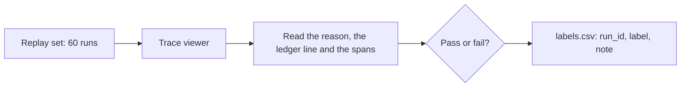
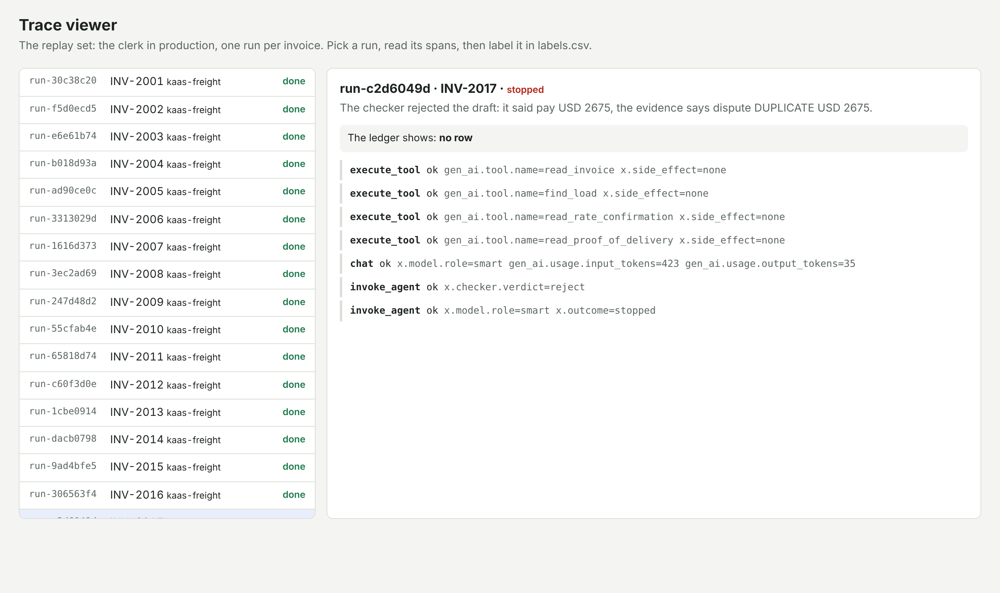

# Label the traces

## The problem

Finance wants to know if a cheaper model is safe. Nobody can answer yet, because nobody has read what the clerk really does.
The board says how much. Only the traces say what went wrong.

The **replay set** is the clerk in production. It is one nightly batch of 60 invoices, with one run each. Each run keeps the
spans it wrote and the ledger rows it left.

The employee's status is only a claim. `stopped` can be the right answer. For example, it may refuse an order hidden in a
scan.

`waiting_for_human` can be right too. An invoice for USD 6,200 must wait for Lena. Only the ledger, compared with the
evidence, says pass or fail.



Notice: Each label is pass or fail.

## Your challenge

Open the trace viewer. Read the runs, and write one row per run in `labels.csv` in this folder.

```bash
bun parts/04-operate/operate.ts traces
```

Expect: "The replay set: 60 runs" and `Trace viewer: http://localhost:7703`.

The viewer keeps running. Open `localhost:7703` in your browser. Use a second terminal for `bun run verify`.



For each run, read the reason, the ledger line and the spans. Ask three questions:

- Did the model draft the right thing?
- Did the checker reject the draft?
- Did a tool call fail?

Then write `pass` or `fail`, and a note in your own words. For example, run `run-c2d6049d` is a duplicate invoice. The draft
said pay. The checker stopped it, and nobody disputed it. So it is a fail:

```csv
run_id,label,note
run-c2d6049d,fail,"Duplicate of an earlier invoice on the load. Draft said pay, checker stopped it, no dispute."
```

Read the runs that did not end `done` first. That is where the failures are. Then read `done` runs until you have at least 30.

## Done when

- `labels.csv` has `run_id,label,note` and at least 30 runs. No run appears twice.
- Every run that did not end `done` is labelled.
- Every label agrees with the ledger. Use `pass` only where the ledger holds what the evidence allows, or the employee rightly
  waits or refuses. Use `fail` everywhere else.

```bash
bun run verify label-the-traces
```

Expect: `Done. All 5 rules pass.`

## If you get stuck

| What you see                                                           | Fix                                                                         |
| ---------------------------------------------------------------------- | --------------------------------------------------------------------------- |
| "labelled fail, but the employee did the right thing"                  | Waiting for Lena, or refusing a hidden order, is a pass. Label the outcome. |
| "labelled pass, but the ledger does not hold what the evidence allows" | Read the ledger line in the viewer. `done` is a claim.                      |
| "runs that did not end done are not labelled"                          | Check the stopped, failed and waiting runs first.                           |
| "is not a run in the replay set"                                       | Copy the run ID from the viewer's left column, such as `run-c2d6049d`.      |

## Words you will use

- **Trace**: the spans that one run wrote, one JSON line each. They include model calls, tool calls, the checker and the
  policy gate.
- **Label**: your pass or fail for one run, with a note. It is never a score out of five.
- **Replay set**: the fixed 60 runs that every learner labels, so the labels can be compared and checked.
