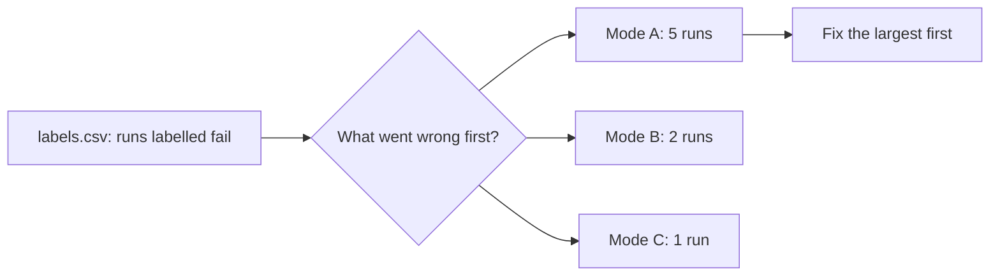

# Count the failure modes

## The problem

Eight runs failed out of 60. That is a number, not a plan. Finance asks which model to use. The engineers ask what to fix
first.

Both need the same thing: the failures grouped by what went wrong, with a count for each group. The biggest group is often not
the model at all.



## Your challenge

Fill the table in `failure-modes.md` in this folder. Use the runs that you labelled `fail` in `label-the-traces`. The check
reads `labels.csv` from that step's folder.

1. Read each failed run's reason and spans again in the trace viewer. Run `bun parts/04-operate/operate.ts traces`.
2. Ask: what went wrong first? Was it a draft the checker rejected, a tool call that failed, or an approval that never came?
3. Give each group a verb-thing name that says what to fix, such as `missed-the-duplicate`. Never use a vague name like
   `agent-errors`.
4. Write one row per mode: its count, its run IDs, and one line on what happened. Put the largest first.

For example, one row for run `run-c2d6049d` from the last step looks like this:

```text
| missed-the-duplicate | 1 | run-c2d6049d | The draft said pay on a load already billed. The checker stopped it. |
```

Keep runs that ended in different ways apart. A job that `failed` on a ledger error needs a different fix from a job that the
checker `stopped` on a wrong draft. In the next step, they also need different evals.

## Done when

- The table has at least two modes. Each has a verb-thing name, and each count equals the run IDs it lists.
- The counts add up to the runs you labelled `fail`. Each failed run is in exactly one mode.
- No mode mixes runs that `failed` with runs that were `stopped`. The rows are largest first.

```bash
bun run verify count-the-failure-modes
```

Expect: `Done. All 5 rules pass.`

## If you get stuck

| What you see                                       | Fix                                                                  |
| -------------------------------------------------- | -------------------------------------------------------------------- |
| "The counts add up to 7; you labelled 8 runs fail" | A failed run is missing from the table, or a count is off by one.    |
| "mixes runs that ended stopped and failed"         | Split the mode. Look at the end status in the viewer.                |
| "is in two modes"                                  | Pick the first thing that went wrong for that run.                   |
| "is not verb-thing"                                | Name it for the fix, in lower case with dashes: `wrong-reason-code`. |

## Words you will use

- **Failure mode**: one way the employee fails, named so that a person knows what to fix.
- **Open coding, then grouping**: first, short notes for each run in your own words. You did that in `labels.csv`. Then you
  group the notes that share a cause.
