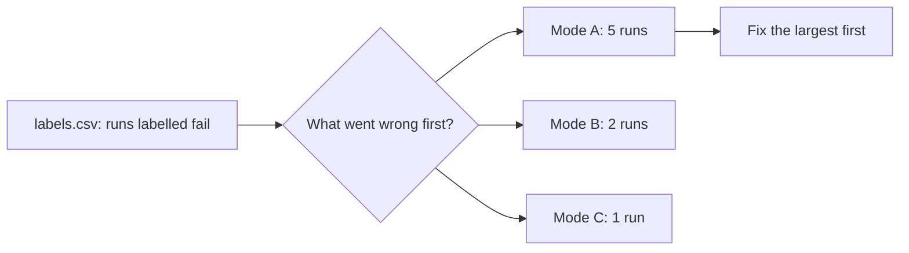

# Count the failure modes

## The problem

Eight runs failing out of 60 is a number, not a plan. Finance asks "which model should we use", the engineers ask
"what do we fix first", and both need the same thing: the failures grouped by what went wrong, with a count. The
biggest group is often not the model at all.



## Your challenge

Fill the table in `failure-modes.md` in this folder from the runs you labelled `fail` in `label-the-traces` (the
check reads `labels.csv` from that step's folder).

1. Read each failed run's reason and spans in the trace viewer again
   (`bun parts/04-operate/operate.ts traces`).
2. Ask: what went wrong first? A draft the checker rejected, a tool call that failed, an approval that never came?
3. Give each group a verb-thing name that says what to fix, such as `missed-the-duplicate`, never `agent-errors`.
4. One row per mode: its count, its run ids and one line on what happened. Largest first.

Keep runs that ended differently apart. A job that `failed` on a ledger error and a job the checker `stopped` on a
wrong draft need different fixes, and in the next step, different evals.

## Done when

- The table has at least two modes, each named verb-thing, each count equal to the run ids it lists.
- The counts add up to the runs you labelled fail, and each failed run is in exactly one mode.
- No mode mixes runs that `failed` with runs that were `stopped`, and the rows are largest first.

```bash
bun run verify count-the-failure-modes
```

Expect: `Done. All 5 rules pass.`

## If you get stuck

| What you see                                       | Fix                                                                  |
| -------------------------------------------------- | -------------------------------------------------------------------- |
| `The counts add up to 7; you labelled 8 runs fail` | A failed run is missing from the table, or a count is off by one.    |
| `mixes runs that ended stopped and failed`         | Split the mode. Look at the end status in the viewer.                |
| `is in two modes`                                  | Pick the first thing that went wrong for that run.                   |
| `is not verb-thing`                                | Name it for the fix, in lower case with dashes: `wrong-reason-code`. |

## Words you will use

- **Failure mode**: one way the employee fails, named so a person knows what to fix.
- **Open coding, then grouping**: first notes per run in your own words (you did that in `labels.csv`), then
  groups of notes that share a cause. The error-discovery method in the reading list describes both.
