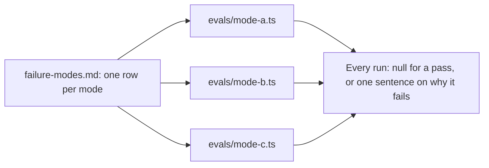

# Write an eval per failure

## The problem

You found three ways the clerk fails. Next month someone changes the prompt or swaps the model. Did the same
failures come back? Without a check, the only way to know is to read 60 traces again. Nobody will.

An **eval** is a small check that reads one run and says pass or fail. One eval per failure mode reads every run
for you, the same way, every time.



## Your challenge

In `evals/` in this folder, write one file for each mode in your `failure-modes.md`. The check reads that file
from `count-the-failure-modes`. Name each eval exactly like its mode, for example `evals/missed-the-duplicate.ts`.
Start from `evals/_example.ts`. It shows the shape, and what a run holds.

An eval is a small function. It returns `null` when the run passes, or one sentence on why it fails. It reads what
the world holds:

- `run.ledger`: the payments and disputes for the invoice;
- `run.approvals`;
- the evidence: `run.invoice`, `run.other_invoices_on_load`, `run.rate` and `run.proof_of_delivery`;
- `run.spans`.

It never reads the employee's reply. It does not trust `run.status` to say the outcome is right.

Return `null` for runs the mode does not apply to. The duplicate eval has nothing to say about a clean invoice.

For example, the eval `missed-the-duplicate` asks three questions about one run:

1. Is there an earlier invoice in `run.other_invoices_on_load`? If not, return `null`.
2. Does `run.ledger` show a payment? Then return a sentence such as
   `INV-2017 bills a load already billed on INV-2012, and the ledger shows it paid`.
3. Is there a `DUPLICATE` dispute, or one waiting for approval? Then return `null`. If not, return a sentence.

Then run your evals over the replay set:

```bash
bun parts/04-operate/operate.ts evals parts/04-operate/04-write-an-eval-per-failure/problem
```

Expect: one line per eval with how many runs it fails, and how many of those you labelled fail and pass.

## Done when

- `evals/` holds one `.ts` file per failure mode, named after the mode, each with a default function.
- Every eval runs on all 60 runs without an error and answers `null` or a sentence.

```bash
bun run verify write-an-eval-per-failure
```

Expect: `Done. All 3 rules pass.`

## If you get stuck

| What you see                                       | Fix                                                                                    |
| -------------------------------------------------- | -------------------------------------------------------------------------------------- |
| `No eval for missed-the-duplicate`                 | The file name must match the mode in `failure-modes.md`, letter for letter.            |
| `threw on run-... : undefined is not an object`    | A run may have no dispute or no payment. Check the array length before you read `[0]`. |
| `returned something other than null or a sentence` | Return `null` for a pass and a string for a fail, nothing else.                        |

## Words you will use

- **Eval**: a check that runs on an employee's output and says pass or fail. Here, a code check on one run.
- **Code eval**: an eval in plain code, not a model judge. Use one whenever the rule can be written down: here every
  mode can. A judge for a matter of taste is the Evals workshop's subject.
