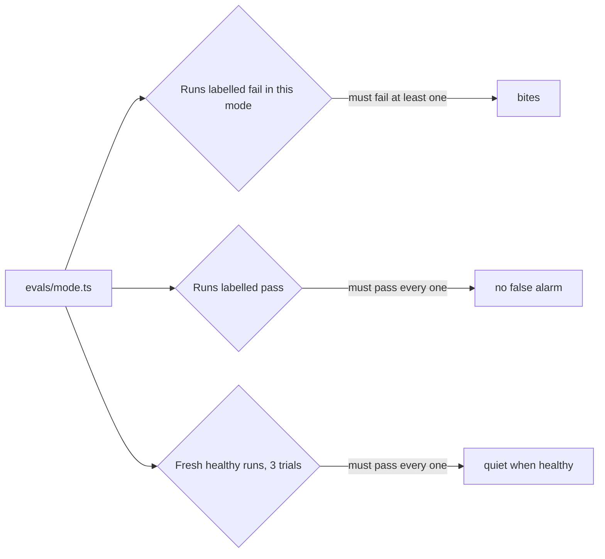

# Prove each eval bites

## The problem

An eval that never fails looks exactly like an eval that works. So does an eval that fails every run, until the
team gets tired of the noise and turns it off. Before the swap gate trusts your evals, prove three things about
each one:

1. It catches the failure it is named for. We say the eval **bites**.
2. It leaves good runs alone.
3. It stays quiet on a healthy clerk.

For example, take `missed-the-duplicate`. It must fail run `run-c2d6049d`, the duplicate you labelled fail. It
must pass every run you labelled pass, such as `run-30c38c20`, a clean invoice paid once at USD 4,305.



## Your challenge

Run your evals against your labels and fix any that do not bite or that bark at good runs:

```bash
bun parts/04-operate/operate.ts evals parts/04-operate/04-write-an-eval-per-failure/problem
```

Expect: for each eval, `fails on` at least 1, `labelled fail` at least 1, and `labelled pass` 0.

Fix the files in `04-write-an-eval-per-failure/problem/evals/`. You can also copy `evals/` into this folder and fix
it here, because the check reads this folder first.

Then the check runs the healthy sample clerk 3 times on a batch of every trap. Lena approves what waits. Your evals
then run on those fresh runs, and must pass every one.

## Done when

- Each eval fails on at least one run you labelled fail in its mode.
- Each eval passes on every run you labelled pass.
- Each eval passes on every fresh run of the healthy clerk, over 3 fresh trials.

```bash
bun run verify prove-each-eval-bites
```

Expect: `Done. All 3 rules pass.`

## If you get stuck

| What you see                         | Fix                                                                                                                   |
| ------------------------------------ | --------------------------------------------------------------------------------------------------------------------- |
| `passes all 5 run(s) in its mode`    | Read one of those runs in the viewer. What does the ledger hold that a good run does not? Check that.                 |
| `fails ..., which you labelled pass` | The eval fires where the mode does not apply. Return `null` first when, for example, there is no earlier invoice on the load. |
| `fails a healthy run of INV-2017`    | A duplicate disputed after Lena approved is right. Accept a `DUPLICATE` dispute, or a dispute waiting for approval.   |

## Words you will use

- **Bite**: an eval bites when it fails on the failure it is named for.
- **False alarm**: an eval that fails a good run. Too many and people stop reading it.
- **Fresh run**: a new world, a new employee process, empty state. Three of them, because one can be lucky.
