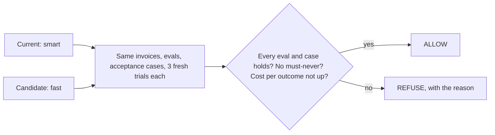
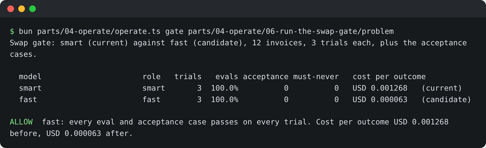

# Run the swap gate

## The problem

Finance has the board. The clerk costs about $0.0013 per settled invoice on the `smart` role. The `fast` role
is about twenty times cheaper per call. They ask: can we swap? "It looked fine when I tried a few" is not an
answer.

A **swap gate** is a real answer. It runs the current model and the candidate model on the same invoices, the same
evals and the same acceptance cases. It runs them several times. Then it compares cost per outcome, not price per
call.

Small gaps lie. Anthropic saw a 6 point swing on one agent benchmark from the machine setup alone. They say not to
trust a gap under 3 points until the setup is the same. So the gate keeps everything the same except the model.

For example, the sample answer ran both models 3 times on 12 invoices. `smart` cost $0.001268 per settled
invoice, and `fast` cost $0.000063. Every eval and every acceptance case held, so the gate said `ALLOW  fast`.



## Your challenge

Fill in `gate.toml` in this folder:

- `evals`: your evals, `"../../04-write-an-eval-per-failure/problem/evals"`.
- `acceptance`: your acceptance cases, `"../../../01-design/03-turn-the-hire-into-tests/problem/acceptance.yaml"`.
- `invoices`: every trap you know (the duplicate `INV-2017`, the above-rate `INV-2023`, the detention and fuel
  invoices, the timeouts, the approvals) and a few clean ones.
- `trials = 3`.

Then run the gate. For each trial, it starts a fresh world and a fresh clerk. It sets `MODEL_ROLE` and `REPLAY_DIR`
for each model. It plays Lena for what waits, and prices every run from its traces.

```bash
bun parts/04-operate/operate.ts gate parts/04-operate/06-run-the-swap-gate/problem
```

Expect: a row per model, then `ALLOW  fast` with cost per outcome before and after.



Write the decision and both numbers in `gate.md`, with what the gate ran.

## Done when

- `gate.toml` names two recorded models, your evals, the invoices and `trials = 3` or more.
- The invoices include the duplicate and the above-rate traps, and `acceptance` points at your acceptance cases.
- `gate.md` has the decision and cost per outcome before and after, matching the gate's own run within 2%.

```bash
bun run verify run-the-swap-gate
```

Expect: `Done. All 4 rules pass.`

## If you get stuck

| What you see                                    | Fix                                                                  |
| ----------------------------------------------- | -------------------------------------------------------------------- |
| `evals = "" is not a folder`                    | Paths are relative to `gate.toml`.                                   |
| `trials = 1`                                    | One run can be lucky. Three fresh trials, and every one must hold.   |
| `gate.md says after USD ...; the gate measured` | Copy cost per outcome from the gate's table, not the price per call. |
| "The gate cannot run"                           | Run the gate command and fix each line it prints.                    |

## Words you will use

- **Swap gate**: a check that must pass before a model change ships, run on both models side by side.
- **Recorded model**: in replay, a role (for its price) and one recorded reply per invoice, in
  `parts/04-operate/06-run-the-swap-gate/models/`. With a live provider, the same gate calls the real models.

Source: [Quantifying infrastructure noise in agentic coding evals, Anthropic](https://www.anthropic.com/engineering/infrastructure-noise), read 2026-11-12.
