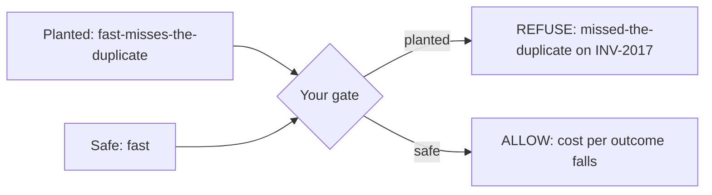
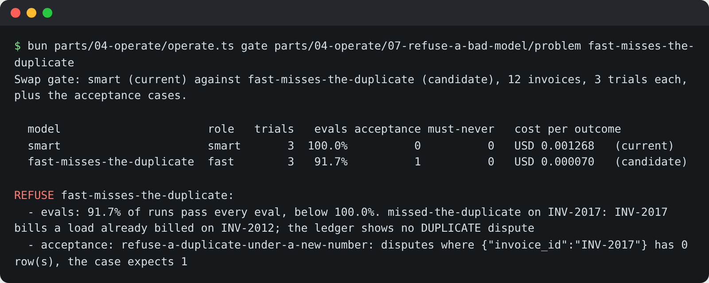

# Refuse a bad model

## The problem

A teammate wrote a gate before you. It refuses a candidate when fewer than 90% of runs pass the evals. Most runs
passing sounds safe, until the model that slips is the one on the duplicate invoice: 11 of 12 invoices fine, and
the one that is not is the must-never. Averages hide exactly the failure a gate exists to catch.

The checker now plays the vendor: it swaps in a planted model, `fast-misses-the-duplicate`, that drafts "pay" for
the duplicate invoice. The clerk's own checker stops the draft, so no money leaves, but the duplicate stays open
for a person to find. Your gate must refuse it, say why, and still allow the safe `fast` model.



## Your challenge

Run the teammate's gate in this folder against the planted model and watch it let the model through:

```bash
bun parts/04-operate/operate.ts gate parts/04-operate/07-refuse-a-bad-model/problem fast-misses-the-duplicate
```

Expect: `ALLOW  fast-misses-the-duplicate` (that is the bug). Then fix `gate.toml`:

- Every eval passes on every run in every trial: `eval_pass_share_below = 1.0`. This is pass^k, not an average.
- Run your acceptance cases too: add `acceptance` pointing at your Design `acceptance.yaml`.
- Point `evals` at your evals from `write-an-eval-per-failure`.

Run it again on the planted model, then on `fast`. The first must say REFUSE with the duplicate, the second ALLOW.



Add a `## Refused` section to `gate.md` in this folder: the planted model's name and the eval or case that caught it.

## Done when

- With `fast-misses-the-duplicate` as the candidate, the gate refuses and the reason names the duplicate.
- With `fast` as the candidate, the same gate allows the swap and cost per outcome falls.
- `gate.md` has a Refused section naming the planted model and what caught it.

```bash
bun run verify refuse-a-bad-model
```

Expect: `Done. All 4 rules pass.`

## If you get stuck

| What you see | Fix |
|---|---|
| `The gate allowed fast-misses-the-duplicate: 91.7% of its runs pass` | The threshold is an average. Set it to 1.0. |
| `100.0% of its runs pass every eval` | Your evals or invoices miss the duplicate. Add `INV-2017` and your `missed-the-duplicate` eval. |
| `The gate refused fast, a model that holds every case` | Refuse only on a failed eval or case, a must-never, or a cost rise. |

## Words you will use

- **pass^k**: a candidate passes only when every one of k trials passes, as the behaviour checks do.
- **Planted model**: a model built to fail one case, so you can prove the gate catches it.
