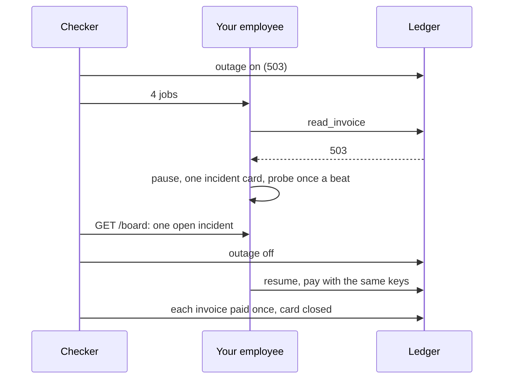

# Run the incident drill

## The problem

The ledger goes down in the middle of the nightly batch. A **503** is the answer a server gives when it is down
for a while: "Service Unavailable".

In the replay set the clerk met exactly this. For example, four jobs got a 503 from the ledger, and each gave up as
`failed`. In the morning four invoices sat open, and nobody was told. That is your largest failure mode,
`failed-on-a-ledger-error`.

There are worse ways to fail. The clerk can retry in a tight loop and hit the ledger hard as it comes back. Or it
can put four alarm cards on the board for one outage.

Anthropic published a postmortem about a drop in quality in its own coding tools. Its evals missed the drop for a
long time. The fixes were about process: more people using the build, evals on every prompt change, and a slow
rollout. The lesson: write the plan for an incident before the incident.



## Your challenge

1. **The employee** lives in `employee/` at the repo root, or in `EMPLOYEE_DIR`. When a tool answers 503:
   - pause the job instead of failing it;
   - probe the ledger once a beat, not once per job per try;
   - resume the job when the ledger answers.

   `GET /board` gets an `incidents` list. It holds one card for the outage with `"status": "open"`. The card
   closes when the jobs resume.
2. **The runbook**: fill in `runbook.md` in this folder. It has five sections:
   - Detect: the signal you see;
   - Stop: how the damage stops;
   - Tell: who hears about it, by name;
   - Fix: how you bring it back, and how you check it;
   - Learn: the eval that catches it next time.

The checker turns the outage on and sends four clean jobs. It reads the board while the ledger is down. Then it
turns the outage off and reads the ledger. A proxy counts your calls to the ledger while it is down. It runs 3
fresh trials.

## Done when

- While the ledger is down no job ends, and the employee calls the ledger at most 60 times.
- `GET /board` shows one open incident during the outage and none open after.
- After the outage every job is `done` and the ledger shows each invoice paid once.
- `runbook.md` has the five sections; Tell names Lena or Ravi; Learn names one of your evals.

```bash
bun run verify run-the-incident-drill
```

Expect: `Done. All 5 rules pass.`

## If you get stuck

| What you see                                    | Fix                                                                    |
| ----------------------------------------------- | ---------------------------------------------------------------------- |
| `the job for INV-2029 ended "failed"`           | Catch a 503 apart from other errors. A 503 means wait, not give up.    |
| `called the ledger 400 times while it was down` | One probe loop for the whole employee, every few hundred milliseconds. |
| `shows 4 open incident(s)`                      | One outage, one card. Add paused jobs to the open card.                |
| `Learn names none of your evals`                | Name the eval file, such as `failed-on-a-ledger-error`.                |

## Words you will use

- **Incident**: something that stops the employee doing its job, handled by people with a plan.
- **Runbook**: the plan, written before: Detect, Stop, Tell, Fix, Learn.
- **Probe**: one cheap read to ask "are you back?", instead of every job retrying on its own.

Source: [An update on recent Claude Code quality reports, Anthropic](https://www.anthropic.com/engineering/april-23-postmortem), read 2026-11-12.
