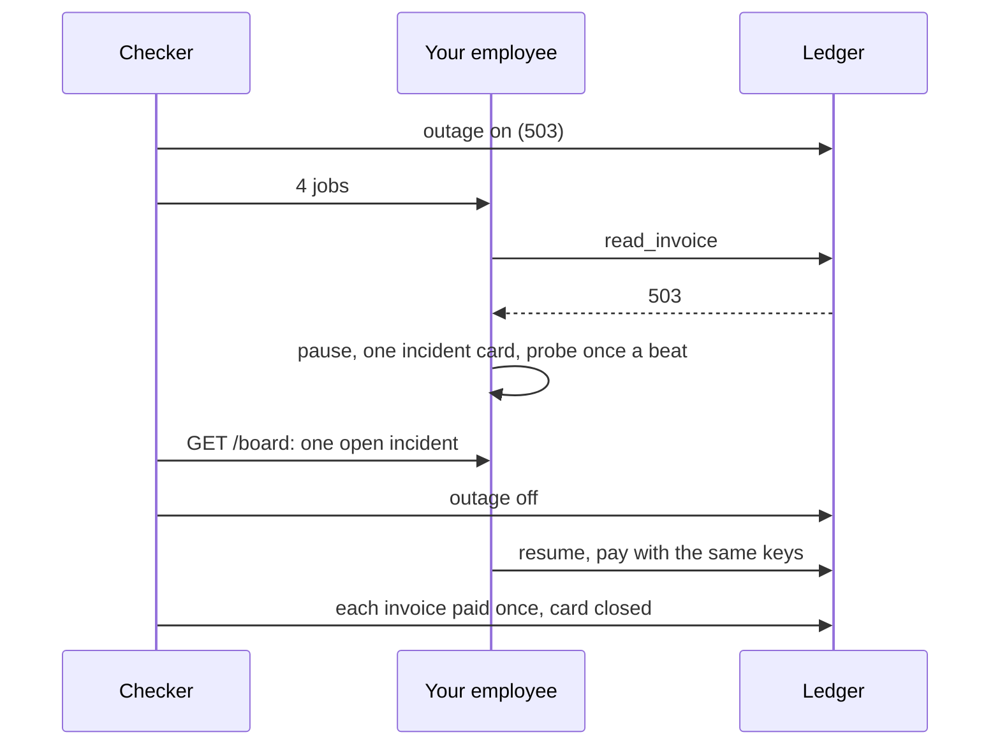

# Run the incident drill

## The problem

The ledger goes down in the middle of the nightly batch. In the replay set the clerk met exactly this: four jobs
hit a 503, each gave up as `failed`, and in the morning four invoices sat open with nobody told. That is your
largest failure mode, `failed-on-a-ledger-error`. Worse ways exist: retry in a tight loop and hammer the ledger
as it comes back, or put four alarm cards on the board for one outage.

Anthropic published a postmortem of a quality regression in its own coding tools that evals missed for a long
stretch; its fixes were process ones: more people using the build, evals on every prompt change, gradual rollout.
An incident needs a plan written before the incident.



## Your challenge

1. **The employee** (`employee/` at the repo root, or `EMPLOYEE_DIR`): on a 503 from a tool, pause the job instead of
   failing it, probe the ledger once a beat (not once per job per try), and resume when it answers. `GET /board`
   gets an `incidents` list: one card for the outage with `"status": "open"`, closed when the jobs resume.
2. **The runbook**: fill in `runbook.md` in this folder: Detect (the signal), Stop (how damage stops), Tell (who
   hears, by name), Fix (how you bring it back and check it) and Learn (the eval that catches it next time).

The checker turns the outage on, sends four clean jobs, reads the board while the ledger is down, turns it off,
then reads the ledger. It counts your calls to the ledger while it is down through a proxy. 3 fresh trials.

## Done when

- While the ledger is down no job ends, and the employee calls the ledger at most 60 times.
- `GET /board` shows one open incident during the outage and none open after.
- After the outage every job is `done` and the ledger shows each invoice paid once.
- `runbook.md` has the five sections; Tell names Lena or Ravi; Learn names one of your evals.

```bash
bun run verify run-the-incident-drill
```

Expect: `Done. All 5 rules pass.`

## If you get stuck

| What you see | Fix |
|---|---|
| `the job for INV-2029 ended "failed"` | Catch a 503 apart from other errors. A 503 means wait, not give up. |
| `called the ledger 400 times while it was down` | One probe loop for the whole employee, every few hundred milliseconds. |
| `shows 4 open incident(s)` | One outage, one card. Add paused jobs to the open card. |
| `Learn names none of your evals` | Name the eval file, such as `failed-on-a-ledger-error`. |

## Words you will use

- **Incident**: something that stops the employee doing its job, handled by people with a plan.
- **Runbook**: the plan, written before: Detect, Stop, Tell, Fix, Learn.
- **Probe**: one cheap read to ask "are you back?", instead of every job retrying on its own.

Source: [An update on recent Claude Code quality reports, Anthropic](https://www.anthropic.com/engineering/april-23-postmortem), read 2026-11-12.
