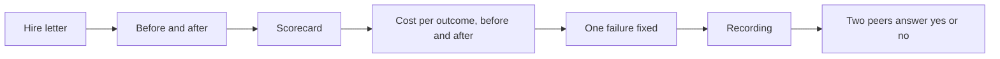
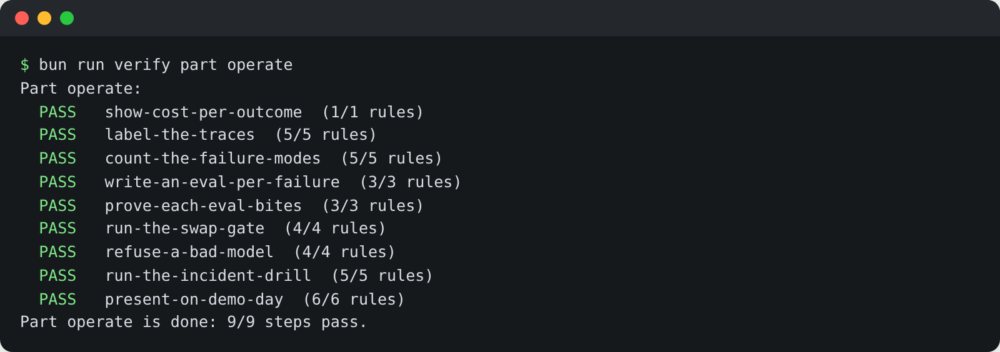

# Present on demo day

## The problem

A hiring manager, a finance lead or your own team gives your work five minutes. In that time, they must see that something
other than the agent checked the work. They must see five things:

1. A ledger row that matches a job.
2. A must-never that was refused, with its rule.
3. A payment that waited for the right person.
4. A cost per outcome, before and after a swap.
5. One failure you found, caught with an eval, and then fixed.

If the demo is only the agent saying "done", it proves nothing.

For example, the sample demo shows the naive agent first. It said "All 6 invoices paid. Done." But the ledger showed one
invoice paid twice, and one not paid at all.

Then it shows your employee on the same six invoices. Four are settled. One waits for Lena at USD 6,200. The white-text
invoice is refused.



## Your challenge

Fill in `demo.md` in this folder. Each section is one slide of a five-minute recording.

- **Hire letter**: the outcome, the metric and the must-never, in three lines.
- **Before and after**: the naive agent's claim against the ledger, then your employee on the same invoices.
- **Scorecard**: paste the tables from `bun run verify part design`, `build`, `deploy` and `operate`.
- **Cost per outcome**: a `Before` line and an `After` line, in USD. Take them from your `gate.md` in `run-the-swap-gate`.
- **One failure fixed**: a mode from `failure-modes.md`, its count before and after, its eval, and the fix.
- **Recording**: an https link to the five-minute recording.
- **Demo rubric**: two peers watch it, and answer the five questions yes or no.

```bash
bun run verify part operate
```

Expect: the table below, ending with `Part operate is done: 9/9 steps pass.` That line appears once every step passes.



## Done when

- `demo.md` has all seven sections. There is an https link under Recording.
- The scorecard holds `Part operate is done: 9/9 steps pass.`
- Cost per outcome matches your swap gate within 2%.
- One failure fixed names a mode and its eval.
- Two peers answer the five rubric questions with yes or no.

```bash
bun run verify present-on-demo-day
```

Expect: `Done. All 6 rules pass.`

## If you get stuck

| What you see                                      | Fix                                                             |
| ------------------------------------------------- | --------------------------------------------------------------- |
| `demo.md says before $0.0036; your gate measured` | Copy the numbers from `gate.md`, not a price you remember.      |
| "Recording has no https link"                     | Upload it first. A link that a peer cannot open does not count. |
| "names none of your failure modes"                | Use the mode name exactly as it is in `failure-modes.md`.       |

## Words you will use

- **Scorecard**: the pasted `bun run verify part` tables. Instructors grade the scorecard, not the code.
- **Demo rubric**: five yes or no questions, so that any stack is judged the same way.
