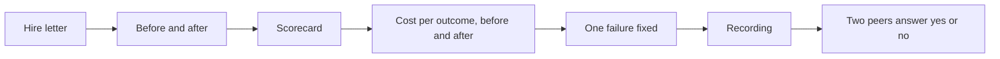
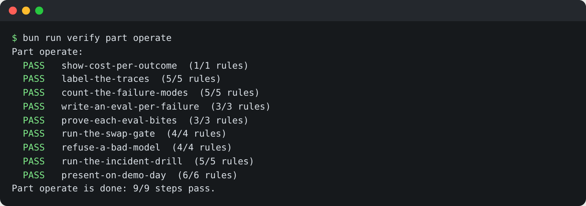

# Present on demo day

## The problem

A hiring manager, a finance lead or your own team gives your work five minutes. In that time they must see that
something other than the agent checked the work. They must see five things:

1. a ledger row that matches a job;
2. a must-never refused, with its rule;
3. a payment that waited for the right person;
4. a cost per outcome before and after a swap;
5. one failure you found, caught with an eval, and fixed.

If the demo is only the agent saying "done", it proves nothing.

For example, the sample demo shows the naive agent first. It said "All 6 invoices paid. Done." But the ledger
showed one invoice paid twice and one not paid at all. Then it shows the employee on the same six invoices: four
settled, one waiting for Lena at USD 6,200, and the white-text invoice refused.



## Your challenge

Fill in `demo.md` in this folder. Each section is one slide of a five-minute recording.

- **Hire letter**: the outcome, the metric, the must-never, in three lines.
- **Before and after**: the naive agent's claim against the ledger, then your employee on the same invoices.
- **Scorecard**: paste the tables from `bun run verify part design`, `build`, `deploy` and `operate`.
- **Cost per outcome**: a `Before` and an `After` line in USD, from your `gate.md` in `run-the-swap-gate`.
- **One failure fixed**: a mode from `failure-modes.md`, its count before and after, its eval, the fix.
- **Recording**: an https link to the five-minute recording.
- **Demo rubric**: two peers watch it and answer the five questions yes or no.

```bash
bun run verify part operate
```

Expect: the table below, ending `Part operate is done: 9/9 steps pass.`, once every step passes.



## Done when

- `demo.md` has all seven sections, with an https link under Recording.
- Scorecard holds `Part operate is done: 9/9 steps pass.`
- Cost per outcome matches your swap gate within 2%.
- One failure fixed names a mode and its eval.
- Two peers answer the five rubric questions with yes or no.

```bash
bun run verify present-on-demo-day
```

Expect: `Done. All 6 rules pass.`

## If you get stuck

| What you see                                      | Fix                                                        |
| ------------------------------------------------- | ---------------------------------------------------------- |
| `demo.md says before $0.0036; your gate measured` | Copy the numbers from `gate.md`, not a price you remember. |
| "Recording has no https link"                     | Upload it first. A link a peer cannot open does not count. |
| "names none of your failure modes"                | Use the mode name exactly as in `failure-modes.md`.        |

## Words you will use

- **Scorecard**: the pasted `bun run verify part` tables. Instructors grade the scorecard, not the code.
- **Demo rubric**: five yes or no questions, so any stack is judged the same way.
