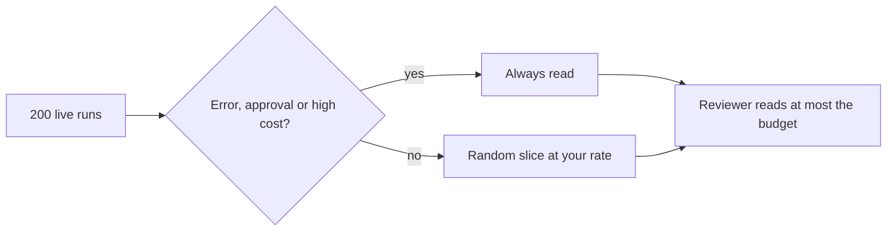

# Sample live runs

## The problem

A day brings 200 runs and a person can read about 30. Reading the first 30 hides the bad ones. Reading a random few
misses the rare bad one. So keep every run that went wrong or cost a lot, then add a small random slice of the rest.

For example, 6 of the 200 runs are errors. All 6 get read, plus about 10 more picked by the dice.



## Your challenge

Fill in `sampling.yaml`:

1. `rate_percent`: the share of ordinary runs you read, between 1 and 20.
2. `reviewer_budget`: how many runs a person reads in a day.
3. Under `always_keep`: set `error` and `approval` to `true`, and set `cost_over_usd` to a price above which a run is always read.

The check replays one sample day from `runs.json`, picks the runs your rules would keep, and counts them.

## Done when

- Every run with an error and every run that needed approval is kept.
- Every run above your cost line is kept.
- The runs kept fit in the reviewer budget.

```bash
bun run verify sample-live-runs
```

Expect: `Done. All 5 rules pass.`

The sample is in [solution/sampling.yaml](../solution/sampling.yaml).

## If you get stuck

| What you see                                    | Fix                                                                             |
| ----------------------------------------------- | ------------------------------------------------------------------------------- |
| `FAIL the runs kept fit in the reviewer budget` | Lower the rate, or raise the budget only if a person can really read that many. |
| `FAIL every error run is kept`                  | Set `error: true` under `always_keep`.                                          |

## Words you will use

- **Sampling**: reading a small share of runs to learn about all of them.
- **Always keep**: a rule that picks a run on purpose, with no dice.
- **Reviewer budget**: the number of runs a person can read in a day.
