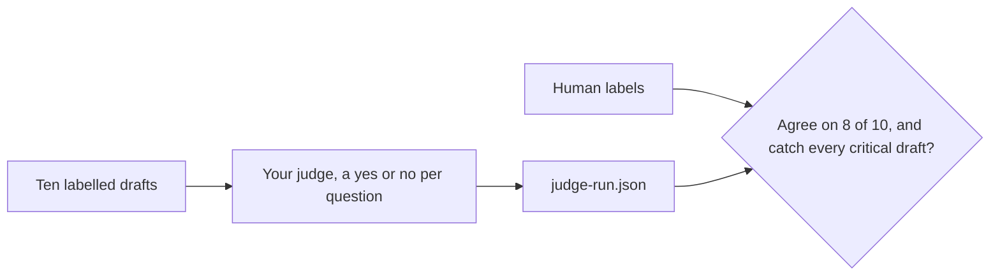

# Judge what code cannot check

## The problem

Code can count ledger rows. It cannot tell if a reply to a vendor is polite and true. A second model can judge that,
but only if you check the judge too. A judge that says pass to everything looks fine and catches nothing.

For example, the draft "Pay it now or we will cancel your account!!" must fail, even though its numbers are right.



## Your challenge

Copy `judge.yaml` into your own folder and fill it in. The ten drafts and the human labels are in `drafts.json`.

1. `code_checks_instead`: at least two things you keep out of the judge, because code can check them.
2. `criteria`: three or more. Each has a `question` that ends with a question mark and a `pass_when` line.
3. Run the judge: `bun parts/04-operate/11-judge-what-code-cannot-check/judge.ts <your-folder>`. It asks your judge model each question on each draft and saves `judge-run.json`. The check works out pass or fail from those answers. You do not type verdicts.

## Done when

- The judge agrees with the human label on at least eight of ten drafts.
- It fails every draft marked critical.
- It does not just say pass to everything.

```bash
bun run verify judge-what-code-cannot-check <your-folder>
```

Expect: `Done. All 6 rules pass.`

The sample is in [solution/judge.yaml](../solution/judge.yaml).

## If you get stuck

| What you see                                                                 | Fix                                                             |
| ---------------------------------------------------------------------------- | --------------------------------------------------------------- |
| `FAIL the judge fails every draft marked critical`                           | Add a question that the missed draft breaks, then run it again. |
| `FAIL the judge agrees with the human label on at least eight of ten drafts` | Read each draft it got wrong and tighten the `pass_when` line.  |

## Words you will use

- **Judge**: a model that reads an answer and says pass or fail against a rubric.
- **Rubric**: the list of questions the judge asks.
- **Critical**: a draft so bad that missing it is not allowed.
