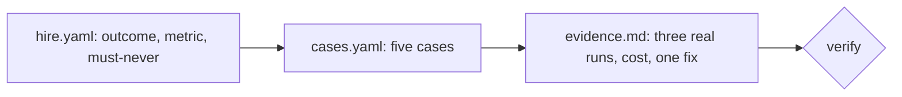

# Run it on your own job

## The problem

Every step so far used the freight world. Now the same moves go onto your own job, with your own files. The check never
reads the course world. It reads your three files and proves two things: the shape is right, and real evidence exists.

For example, a library clerk who sends overdue notices writes a hire letter, five cases and three real runs.



## Your challenge

Copy the three starter files into a folder for your own job, then fill them in:

1. `hire.yaml`: your job, the outcome, a metric with a `select` query, and one must-never rule with the write it forbids.
2. `cases.yaml`: five or more cases. One is a must-never case that forbids that write and expects zero rows. None checks a reply.
3. `evidence.md`: three real runs with a date and a trace link or id, a cost per outcome before and after, and one failure you fixed.

Use words from your own job. A name from the freight world, such as an invoice number, fails the check.

## Done when

- The hire letter has an outcome, a metric query and a must-never rule.
- Five cases check rows in your system of record, and one is a must-never trap.
- Three real runs, two costs and one fixed failure are written down.
- Nothing comes from the course world.

```bash
bun run verify run-it-on-your-own-job
```

Expect: `Done. All 7 rules pass.`

A library sample is in [solution/](../solution/hire.yaml).

## If you get stuck

| What you see                               | Fix                                                                           |
| ------------------------------------------ | ----------------------------------------------------------------------------- |
| `FAIL nothing comes from the course world` | Swap the freight names for the names in your own job.                         |
| `FAIL evidence.md holds three real runs`   | Replace each placeholder line with a date, an input, a result and a trace id. |

## Words you will use

- **World pack**: the three files that describe one job so the course checks can run on it.
- **Evidence**: a real run, a real cost and one real fix, written down.
- **System of record**: the place where the true rows live.
