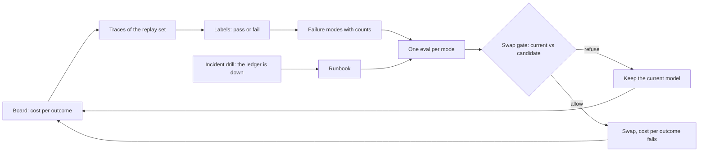

# Operate

The clerk works. Now finance asks two questions. What does one settled invoice cost? And is a model about twenty
times cheaper per call safe to use? Nobody can answer, because nobody has read what the clerk does in production.

In this part you answer both questions:

1. You put cost per outcome on the board. An **outcome** is one invoice the clerk finished, paid or not.
2. You read 60 real runs and label each one pass or fail.
3. You group the fails into kinds, and turn each kind into an **eval**: a small check that runs on every trace.
4. You build a **gate**. It refuses a cheaper model that would leave a duplicate invoice open.
5. You practise the night the ledger goes down.
6. You end with a five-minute demo.

For example, the replay set has 60 runs. `bun parts/04-operate/operate.ts traces` prints:
`The replay set: 60 runs of the clerk in production (49 done, 2 waiting, 4 stopped, 5 failed).` The 5 failed
runs still cost money, so the board counts them too.

Why a gate and not a quick try? The machine you test on changes the score. Anthropic saw a 6 point swing on one
agent benchmark from the machine setup alone. They say not to trust any gap under 3 points until the setup is the
same ([Quantifying infrastructure noise in agentic coding evals](https://www.anthropic.com/engineering/infrastructure-noise),
read 2026-11-12). So a gate keeps everything the same except the model. It runs three times, and every trial must
pass.



The same picture is in `operate-loop.mmd`.

## Steps

| Step                                                                              | What you make                                                            | Minutes |
| --------------------------------------------------------------------------------- | ------------------------------------------------------------------------ | ------- |
| [show-cost-per-outcome](01-show-cost-per-outcome/problem/README.md)               | `GET /board` with spend and cost per outcome, failed runs included       | 30      |
| [label-the-traces](02-label-the-traces/problem/README.md)                         | `labels.csv`: at least 30 of 60 runs, pass or fail with a note           | 25      |
| [count-the-failure-modes](03-count-the-failure-modes/problem/README.md)           | `failure-modes.md`: modes with counts that add up                        | 20      |
| [write-an-eval-per-failure](04-write-an-eval-per-failure/problem/README.md)       | `evals/`: one code check per mode                                        | 25      |
| [prove-each-eval-bites](05-prove-each-eval-bites/problem/README.md)               | evals that fail their mode and pass good runs                            | 20      |
| [run-the-swap-gate](06-run-the-swap-gate/problem/README.md)                       | `gate.toml` and `gate.md`: two models, cost per outcome before and after | 20      |
| [refuse-a-bad-model](07-refuse-a-bad-model/problem/README.md)                     | a gate that refuses the planted model and allows the safe one            | 25      |
| [run-the-incident-drill](08-run-the-incident-drill/problem/README.md)             | pause on a ledger outage, one incident card, `runbook.md`                | 30      |
| [present-on-demo-day](09-present-on-demo-day/problem/README.md)                   | `demo.md`, a five-minute recording, the scorecard                        | 30      |
| [sample-live-runs](10-sample-live-runs/problem/README.md)                         | `sampling.yaml`: a rate, always-keep rules, a reviewer budget            | 20      |
| [judge-what-code-cannot-check](11-judge-what-code-cannot-check/problem/README.md) | `judge.yaml`: a rubric checked against human labels                      | 20      |
| [run-it-on-your-own-job](12-run-it-on-your-own-job/problem/README.md)             | a world pack and evidence for your own job                               | 30      |

`show-cost-per-outcome`, `run-the-swap-gate` and `refuse-a-bad-model` are core. A PM can do steps 2 to 7 and 9
alone: they are files, and the gate runs the part's sample clerk.

**What is in this folder.**

- `kit.ts` is the sample clerk for this part. It is the reference clerk with a model setting, an honest board, and
  a pause when the ledger is down. `MODEL_ROLE` picks the role in `config/models.ts`. `REPLAY_DIR` picks the
  recorded replies.
- `02-label-the-traces/runs/` is the replay set: 60 runs of the clerk in production, on the `smart` role.
- `06-run-the-swap-gate/models/` holds the recorded models the gate can run: `smart`, `fast` and the planted
  `fast-misses-the-duplicate`.
- `operate.ts` runs the trace viewer, your evals and the gate.

Your own employee plays steps 1 and 8. To gate it, give it `MODEL_ROLE`. Then point `employee` in `gate.toml` at
it, with a live provider.

## Walkthrough

Your employee from Build and Deploy lives in `employee/` at the repo root. The board must count every run:

```bash
bun run verify show-cost-per-outcome
```

Expect: `Done. All 1 rules pass.`

Open the replay set and label at least 30 runs in `02-label-the-traces/problem/labels.csv`, the ones that did not
end `done` first.

```bash
bun parts/04-operate/operate.ts traces
```

Expect: `The replay set: 60 runs of the clerk in production (49 done, 2 waiting, 4 stopped, 5 failed).`

The trace viewer keeps running on `localhost:7703`. Open it in your browser. Run the next commands in a second
terminal, and press Ctrl+C to stop the viewer when you are done.

```bash
bun run verify label-the-traces
```

Expect: `Done. All 5 rules pass.`

Group the fails in `03-count-the-failure-modes/problem/failure-modes.md`.

```bash
bun run verify count-the-failure-modes
```

Expect: `Done. All 5 rules pass.`

Write one eval per mode in `04-write-an-eval-per-failure/problem/evals/`, then run them over the replay set.

```bash
bun parts/04-operate/operate.ts evals parts/04-operate/04-write-an-eval-per-failure/problem
bun run verify write-an-eval-per-failure
```

Expect: one line per eval with `labelled pass` at 0, then `Done. All 3 rules pass.`

```bash
bun run verify prove-each-eval-bites
```

Expect: `Done. All 3 rules pass.`

Fill in `06-run-the-swap-gate/problem/gate.toml`, run the gate, and write `gate.md`.

```bash
bun parts/04-operate/operate.ts gate parts/04-operate/06-run-the-swap-gate/problem
bun run verify run-the-swap-gate
```

Expect: `ALLOW  fast` with cost per outcome about USD 0.001268 before and USD 0.000063 after, then `Done. All 4 rules pass.`

Fix the teammate's gate in `07-refuse-a-bad-model/problem/gate.toml` until it refuses the planted model.

```bash
bun parts/04-operate/operate.ts gate parts/04-operate/07-refuse-a-bad-model/problem fast-misses-the-duplicate
bun run verify refuse-a-bad-model
```

Expect: `REFUSE fast-misses-the-duplicate` naming `missed-the-duplicate`, then `Done. All 4 rules pass.`

Make your employee pause when the ledger answers 503, and write `08-run-the-incident-drill/problem/runbook.md`.

```bash
bun run verify run-the-incident-drill
```

Expect: `Done. All 5 rules pass.`

Record the demo and fill in `09-present-on-demo-day/problem/demo.md`.

```bash
bun run verify present-on-demo-day
```

Expect: `Done. All 6 rules pass.`

Check the whole part. The part's deliverable is `bun run verify part operate`.

```bash
bun run verify part operate
```

Expect:

```text
Part operate:
  PASS   show-cost-per-outcome  (1/1 rules)
  PASS   label-the-traces  (5/5 rules)
  PASS   count-the-failure-modes  (5/5 rules)
  PASS   write-an-eval-per-failure  (3/3 rules)
  PASS   prove-each-eval-bites  (3/3 rules)
  PASS   run-the-swap-gate  (4/4 rules)
  PASS   refuse-a-bad-model  (4/4 rules)
  PASS   run-the-incident-drill  (5/5 rules)
  PASS   present-on-demo-day  (6/6 rules)
Part operate is done: 12/12 steps pass.
```

## Assignment

**The problem.** Finance asks whether a cheaper model is safe. Nobody has read the traces.

**What you hand in.** `labels.csv`, `failure-modes.md`, `evals/`, `gate.toml` and `gate.md`, `runbook.md`, and
`demo.md` with the recording link, as the part's deliverable: `bun run verify part operate`.

**How it is checked.** Every rule is yes or no:

| Question                                                                                       | Checked by       |
| ---------------------------------------------------------------------------------------------- | ---------------- |
| Does `bun run verify part operate` pass every step from a fresh clone?                         | Script           |
| Does each eval fail on a labelled fail of its mode and pass every labelled pass?               | Script           |
| Is the planted model that misses the duplicate refused, and the safe one allowed?              | Script           |
| Does the recording show a ledger row that matches a job the employee reported done?            | Peer, yes or no  |
| Does the recording show the must-never trap refused and the refusal logged with its rule?      | Peer, yes or no  |
| Does the recording show a payment that waited for the right approver?                          | Peer, yes or no  |
| Does the write-up state cost per outcome before and after a swap, matching the gate within 2%? | Script plus peer |
| Does the write-up name one failure mode, the eval that catches it, and the fix?                | Peer, yes or no  |

**Extension.** Add a model judge for one failure mode that code cannot check, and report how often it agrees with
your labels. Judge calibration in depth belongs to the Evals workshop.

## Finished

You now have an employee you can run as a service, not a demo. You have:

- a board that prices each outcome from the traces, with failed runs counted;
- 60 labelled runs and failure modes with counts;
- an eval per mode, proven to catch its mode;
- a swap gate that allowed a model about twenty times cheaper per outcome, and refused one that leaves a duplicate
  open;
- a runbook, and an employee that survives a ledger outage;
- a five-minute demo with a scorecard.

This is the last part. The deliverable for the whole course is every part's `bun run verify part` table in your
demo. From here, the sibling courses go deeper where this one stops:

- the Evals workshop: judges and eval CI;
- the Deploy workshop: identity, canary releases and rollback;
- the Agentic AI Architecture workshop: a platform for many teams.
