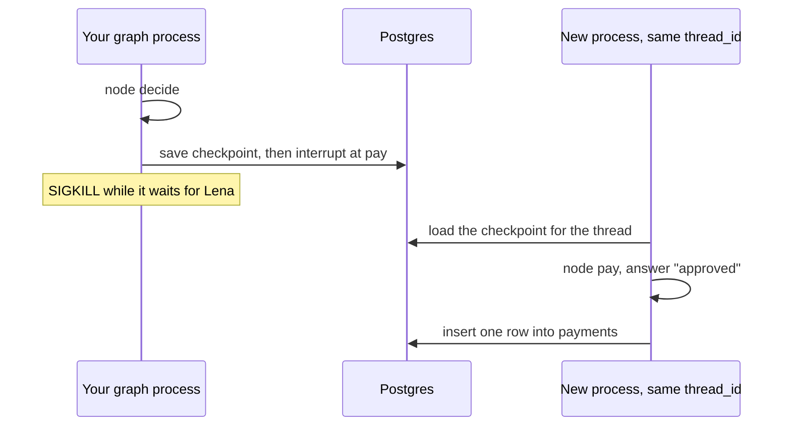

# Resume with LangGraph

## The problem

In Build you made the clerk wait for Lena when an invoice is over her limit. In Deploy you saved its progress
in files, so a crash did not make it pay twice. You wrote that code by hand, and it works. Most teams do not
write it by hand. They use a graph library with a database behind it.

LangGraph is that library. A **graph** is a list of steps, called nodes, joined by arrows. Your graph has two
nodes: `decide` and `pay`. When the amount is over Lena's limit, `pay` calls `interrupt()`. That pauses the
graph and saves it in Postgres. Later, a new process can carry on from the pause.

For example, run `7850` through the graph. `decide` runs, then `pay` stops and waits for Lena. You kill the
process. You start a new one and answer "approved". The new process starts at `pay`, not at `decide`, and the
ledger gets one payment row.



## Your challenge

Work in the `assignment/` folder. Open `graph.ts` or `graph.py`. Both nodes are stubs. Pick one language.

1. Add the pinned packages. TypeScript: `bun add @langchain/langgraph@1.7.4 @langchain/langgraph-checkpoint-postgres@1.1.3`.
   Python: `uv add langgraph==1.2.21 langgraph-checkpoint-postgres==3.2.0 --project assignment`.
2. Make `decide` choose to pay.
3. Make `pay` call `interrupt()` when the amount is over your approval limit, and carry on only on "approved".
4. Write one row to `payments`. The table has a unique key on `run_id`, so running `pay` twice is safe.
5. Swap the in-memory saver for the Postgres checkpointer, and call its `setup()` once.

Start the database first. The Walkthrough in the part README has the commands.

## Done when

- The LangGraph package in the lockfile is the pinned version.
- A run above the limit stops at an interrupt and writes a checkpoint row.
- After the script kills and restarts the process, the run resumes on the same `thread_id`.
- The ledger has exactly one payment row for that run.
- A run below the limit finishes with no interrupt.

```bash
bun run verify resume-with-langgraph
```

Expect: `Done. All 5 rules pass.` once your graph is built. The check starts Postgres for you, and removes it when it ends.

## If you get stuck

| What you see                                 | Fix                                                                           |
| -------------------------------------------- | ----------------------------------------------------------------------------- |
| `SKIP` on every line                         | Docker is not running. Start it, then run the check again.                    |
| The run never prints `PAUSED`                | `pay` must call `interrupt()` above the limit, and `invoke` returns after it. |
| `node decide` prints again after the restart | The saver is in memory. Use the Postgres checkpointer so the thread survives. |
| The ledger has 2 rows, or the insert fails   | Use `on conflict do nothing` on the insert, so a second run writes nothing.   |

## Words you will use

- **Graph**: steps (nodes) joined by arrows. The library runs one node after another.
- **interrupt()**: pauses the graph at this point and returns the answer later.
- **Checkpoint**: the graph's saved state after a node. A checkpointer keeps it in a database.
- **thread_id**: the name of one run. The same name finds the same saved state.
