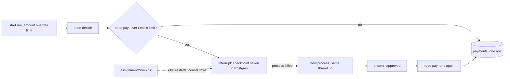

# Run the agent on LangGraph

## The problem

You built the clerk's pause and its saved progress by hand. That is the right way to learn them. But on a real
team, nobody keeps a progress file by hand for long. They use a library that does it, and a database behind it.
You need to know what that library does for you, and what it still leaves to you.

For example, your Deploy employee saves each job in `STATE_DIR` and sends a stable Idempotency-Key. A graph
library saves the same facts as checkpoints in Postgres. Your approval rule stays yours. Only the plumbing moves.

## Why it matters

A pause that lives in a file on one machine is lost when the machine is. A pause in Postgres is not. Any new
process can find it by name and carry on. So teams run agents on a graph library with a database checkpointer.
This part redoes one thing you built by hand with it.

## What we teach

- Graph, node, interrupt and checkpoint, shown on the approval pause you already know.
- Resume on the same `thread_id`: the second process starts at `pay`, not at `decide`.
- Why a node that can run twice must write once. The pause makes `pay` start again from its top.



## Steps

| Step                                                                | Min | You build                                             | The check reads                                                        |
| ------------------------------------------------------------------- | --- | ----------------------------------------------------- | ---------------------------------------------------------------------- |
| [resume-with-langgraph](01-resume-with-langgraph/problem/README.md) | 30  | `assignment/graph.ts` or `graph.py`, a two-node graph | The lockfile, an interrupt, a checkpoint row, a resume, one ledger row |

Work in the `assignment/` folder at the repo root. It has its own `compose.yml`, `ledger.sql` and check. The
sample answer is in `01-resume-with-langgraph/solution/`, in TypeScript and Python.

## Options

The tool in this part is LangGraph with the Postgres checkpointer. The runner-up is Google ADK.

- **Choose when:** the team is on Google Cloud, or wants one framework across Python, TypeScript, Go and Java.
- **Trade-off:** its session and resume model differs from the one you built by hand, so the mapping is less direct.

## Walkthrough

Start Postgres. This needs Docker running. The first start pulls an image, so it can take a minute.

```bash
docker compose -f assignment/compose.yml up -d --wait
```

Expect: "Container assignment-db-1 Healthy".

Run the sample answer's graph above Lena's limit. It pauses and keeps running, like a clerk waiting for her.

```bash
bun parts/05-run-the-agent-on-langgraph/01-resume-with-langgraph/solution/graph.ts start run-1 7850
```

Expect: `node decide`, `node pay`, then "PAUSED waiting for Lena". Press Ctrl+C to kill it. The process is gone. Postgres still has the pause.

Start a new process on the same run. It answers "approved".

```bash
bun parts/05-run-the-agent-on-langgraph/01-resume-with-langgraph/solution/graph.ts resume run-1
```

Expect: `node pay` and `DONE paid`, and no `node decide`. The second run starts at `pay`.

Count the payments for that run.

```bash
docker compose -f assignment/compose.yml exec db psql -U postgres -d assignment -tAc "select count(*) from payments where run_id = 'run-1'"
```

Expect: `1`.

Stop and remove the database.

```bash
docker compose -f assignment/compose.yml down -v
```

Expect: `Removed` for the container, the volume and the network.

Now build your own in `assignment/`. Check it by name, in either language:

```bash
bun run verify resume-with-langgraph
```

Expect: `Done. All 5 rules pass.` when your graph is built. On the untouched starter, four lines say `FAIL`.

The same check also runs from Python, and it writes `assignment/result.json`:

```bash
uv run assignment/check.py
```

Expect: `Every line passes.` once your graph is built, and `assignment/result.json` with one `pass` or `fail` per line.

## Watch and read

| Kind  | Title                                                                   | Who made it    | Why                                                              | Link                                                                                         |
| ----- | ----------------------------------------------------------------------- | -------------- | ---------------------------------------------------------------- | -------------------------------------------------------------------------------------------- |
| video | LangGraph interrupt: Making it easier to build human-in-the-loop agents | LangChain      | The team behind the library shows how a pause and a resume work. | https://www.youtube.com/watch?v=6t7YJcEFUIY                                                  |
| video | LangGraph: Persistence                                                  | LangChain      | The team behind the library shows what a checkpoint saves.       | https://www.youtube.com/watch?v=YE6A5d8kNp4                                                  |
| read  | Persistence                                                             | LangChain docs | What a checkpoint saves and how a thread resumes.                | https://docs.langchain.com/oss/python/langgraph/persistence                                  |
| read  | Interrupts                                                              | LangChain docs | How a graph pauses for a person and then resumes.                | https://docs.langchain.com/oss/python/langgraph/interrupts                                   |
| read  | Making it easier to build human-in-the-loop agents with interrupt       | LangChain blog | The team explains why a paused run is saved and how it resumes.  | https://blog.langchain.com/making-it-easier-to-build-human-in-the-loop-agents-with-interrupt |

## Assignment

This part is optional in the live session and expected as homework. Work on it beside the class while the
concepts are taught with the hand-built versions. The full task is in [assignment/README.md](../../assignment/README.md).

**What you hand in.** A branch named `assignment`, pushed, with your URL submitted. The grader reruns the same check.

## FINISHED

You now know what a graph library takes off your hands: the pause, the saved state and the resume. You also
know what it leaves with you: your approval rule, and a pay node that is safe to run twice.
