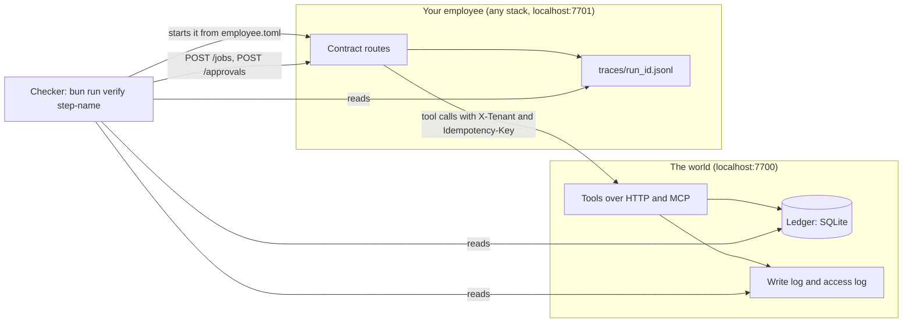

# The contract, version 1

Your employee and the checker talk through this contract and nothing else. The checker never imports your code,
so any language, SDK or model can pass. The checker sends jobs and plays the people. Then it reads the ledger, the
world's logs and your traces. Your employee's reply is only a claim. The ledger decides.



## employee.toml

The checker reads this file to start your employee. The file sits in the folder the check points at. The `[hire]`
block is the hire letter you write in the Design part, in the step `write-the-hire-letter`. Its queries run on the
world's ledger.

```toml
[hire]
name = "freight-audit-clerk"
outcome = "Each carrier invoice is paid once at the rate confirmation's amount, or disputed with a reason code the papers support"
starts_by = ["person"]           # person, event, schedule or agent
lives = "one job"                # one job, one case, or always on

[hire.metric]
name = "cost per invoice settled"
query = "SELECT COUNT(*) AS settled FROM invoices i WHERE i.tenant = 'kaas-freight' AND (EXISTS (SELECT 1 FROM payments p WHERE p.invoice_id = i.invoice_id) OR EXISTS (SELECT 1 FROM disputes d WHERE d.invoice_id = i.invoice_id))"
note = "Model spend divided by this count. Also watch the share settled with no human."

[hire.must_never]
rule = "Pay the same load twice, or pay above the rate confirmation without Lena's approval"
write = "pay_invoice"
check = "SELECT i.load_id, COUNT(*) AS payments FROM payments p JOIN invoices i ON i.invoice_id = p.invoice_id GROUP BY i.load_id HAVING COUNT(*) > 1"

[contract]
version = "1"
mode = "http"                    # or "cli"
start = "bun start.ts"           # run from this folder; for mode = "cli" it is the command that takes the action
url = "http://localhost:7701"
traces = "traces"                # folder for traces/<run_id>.jsonl, relative to this file

[budget]
max_steps = 12
max_usd_per_job = 0.05
max_usd_per_day = 5
```

When the checker starts your employee, it sets these environment variables. Use them when they are set.

| Variable     | What it is                                                                                                |
| ------------ | --------------------------------------------------------------------------------------------------------- |
| `PORT`       | The port to answer the contract on. It overrides the port in `url`.                                       |
| `WORLD_URL`  | Where the world's tools are. Defaults to `http://localhost:7700`.                                         |
| `TRACE_DIR`  | Where to write traces. It overrides `traces`.                                                             |
| `STATE_DIR`  | A fresh, empty folder for your saved state on each trial. Keep job progress here.                         |
| `MODEL_MODE` | `replay` in checks, so a recorded reply answers and no model key is needed, if your employee supports it. |

## The six routes

| Action         | HTTP                                                                                       | Answer                                                                                                                       |
| -------------- | ------------------------------------------------------------------------------------------ | ---------------------------------------------------------------------------------------------------------------------------- |
| Health         | `GET /health`                                                                              | {"contract": "1", "employee": "freight-audit-clerk", "tenants": ["kaas-freight"]}                                            |
| Start a job    | `POST /jobs` with {"job_id", "tenant", "trigger": {"kind", "by"}, "input": {"invoice_id"}} | 202 {"job_id", "run_id"}. The same `job_id` again starts nothing new and answers the first `run_id`                          |
| Read a job     | `GET /jobs/{job_id}`                                                                       | {"status", "reason", "cost_usd"}. `status` is one of `working`, `waiting_for_human`, `done`, `declined`, `stopped`, `failed` |
| List approvals | `GET /approvals?status=waiting`                                                            | [{"approval_id", "job_id", "action", "amount", "summary", "approver_role"}]                                                  |
| Decide         | `POST /approvals/{approval_id}` with {"decision": "approve" or "decline", "by": "lena"}    | `200`, or `403 {"reason"}` when that person may not decide it                                                                |
| Board          | `GET /board`                                                                               | `{"tenants": [{"tenant", "outcomes", "spend_usd", "cost_per_outcome_usd", "by_employee": [...]}]}`                           |

`trigger.kind` is `person`, `event`, `schedule` or `agent`. The checker never believes `status: done` alone. If a
job says `done` but the ledger has no row for it, the step fails. The check prints the invoice that has no row.

For example, the checker sends `POST /jobs` for tenant `kaas-freight` and invoice `INV-2045`. Your employee answers
`202` with a `run_id`. The invoice is USD 6,200, over Ravi Shah's limit of USD 5,000. So the job goes to
`waiting_for_human`, and `GET /approvals?status=waiting` lists it with `amount` 6200. Lena then posts
{"decision": "approve", "by": "lena"}. If Jo Park, a contractor, posts the same decision, your employee answers
`403` with a reason.

## The same six as CLI commands

Set `mode = "cli"`. The checker runs `start` with the action as its last argument. It writes the request as JSON
on stdin, then reads one JSON answer from stdout. Exit 0 for success. For a refusal, print
{"status": 403, "reason"}.

| Action         | Command                  | stdin                             |
| -------------- | ------------------------ | --------------------------------- |
| Health         | `<start> health`         | `{}`                              |
| Start a job    | `<start> start-job`      | the job, as for `POST /jobs`      |
| Read a job     | `<start> read-job`       | `{"job_id"}`                      |
| List approvals | `<start> list-approvals` | `{"status": "waiting"}`           |
| Decide         | `<start> decide`         | {"approval_id", "decision", "by"} |
| Board          | `<start> board`          | `{}`                              |

Each command is a new process, so a CLI employee keeps its jobs in `STATE_DIR`. `start-job` may run the whole job
before it answers. Some steps stop a running employee on purpose. Those steps need `mode = "http"`.

## The world's tools

Call a tool in one of two ways. Send `POST {WORLD_URL}/tools/<name>` with a JSON body. Or use MCP at
`{WORLD_URL}/mcp`, with the JSON-RPC calls `tools/list` and `tools/call`.

Every call sends `X-Tenant`, the job's tenant. A tenant is one company in the shared ledger. Also send `X-Employee`
and `X-Job-Id`, because the world's access log uses them.

Write tools need an `Idempotency-Key` header. Over MCP, it is an `idempotency_key` argument. An idempotency key is a
name you give one action, so a repeat of it does nothing new. The same key with the same request gets the first
result back and writes nothing new.

For example, your employee calls `pay_invoice` for `INV-2043` with USD 1,580 and the key `pay-INV-2043`. The call
writes the payment, then times out. Your employee tries again with the same key. The world answers with the first
result and writes no second payment.

| Tool                     | Kind           | Takes                                                                       |
| ------------------------ | -------------- | --------------------------------------------------------------------------- |
| `find_load`              | read           | `load_id`                                                                   |
| `read_invoice`           | read           | `invoice_id`                                                                |
| `read_rate_confirmation` | read           | `load_id`                                                                   |
| `read_proof_of_delivery` | read           | `load_id`                                                                   |
| `pay_invoice`            | final write    | `invoice_id`, `amount_usd`, `approved_by` (optional)                        |
| `open_dispute`           | undoable write | `invoice_id`, `reason_code`, `amount_usd`, `note`, `approved_by` (optional) |
| `email_carrier`          | undoable write | `carrier_id`, `subject`, `body`                                             |

The reason codes are `DUPLICATE`, `ABOVE_RATE`, `DETENTION_UNSIGNED`, `FUEL_ABOVE_CONTRACT` and `OTHER`. You find
the people and their limits at `GET {WORLD_URL}/people`.

## The trace format

A trace is the record of what one run did. Write it to `<traces>/<run_id>.jsonl`, with one JSON object per line.
Each line is one span, a single timed piece of work, such as one tool call.

```json
{
  "format": "employee.trace/v1",
  "trace_id": "run-1a2b",
  "span_id": "s2",
  "parent_span_id": "s1",
  "name": "execute_tool",
  "start_time": "2026-11-16T10:00:01.000Z",
  "end_time": "2026-11-16T10:00:01.040Z",
  "status": "ok",
  "attributes": {
    "gen_ai.tool.name": "read_invoice",
    "gen_ai.tool.call.id": "c1",
    "x.side_effect": "none"
  }
}
```

`name` is the kind of work. Use `invoke_agent` for a run of an agent, with one root span per job run. Use `chat`
for a model call, and `execute_tool` for a tool call. Attributes use the OpenTelemetry GenAI names, unchanged.

| Attribute                                                 | On             | Meaning                                             |
| --------------------------------------------------------- | -------------- | --------------------------------------------------- |
| `gen_ai.agent.name`                                       | `invoke_agent` | The employee, or a role inside it such as `checker` |
| `gen_ai.request.model`                                    | `chat`         | The model asked                                     |
| `gen_ai.usage.input_tokens`, `gen_ai.usage.output_tokens` | `chat`         | Tokens, as the provider counted them                |
| `gen_ai.usage.cache_read.input_tokens`                    | `chat`         | Input tokens read from the cache                    |
| `gen_ai.tool.name`, `gen_ai.tool.call.id`                 | `execute_tool` | The tool and this call                              |

OpenTelemetry has no names for jobs, cost, outcomes or approvals. So a small set of `x.` names adds them.

| Attribute                                              | On                           |
| ------------------------------------------------------ | ---------------------------- |
| `x.job.id`, `x.tenant`, `x.trigger.kind`, `x.outcome`  | the root span                |
| `x.idempotency_key`, `x.side_effect` (`none`, `write`) | a tool call                  |
| `x.approval.decision`, `x.approval.by`                 | an approval                  |
| `x.role` (`checker`)                                   | a checker span               |
| `x.policy.rule`, `x.policy.decision`                   | a span named `x.policy_gate` |

If you already export OpenTelemetry spans, each span maps to exactly one span here. The GenAI names come from
`open-telemetry/semantic-conventions-genai`. That project has no release yet. This file copies the names as they
are there today.

The checker never takes the cost from you. It works out the cost from the token counts and the dated price table
in `config/models.ts`. If the price table is older than the age limit set there, the checker refuses it.
