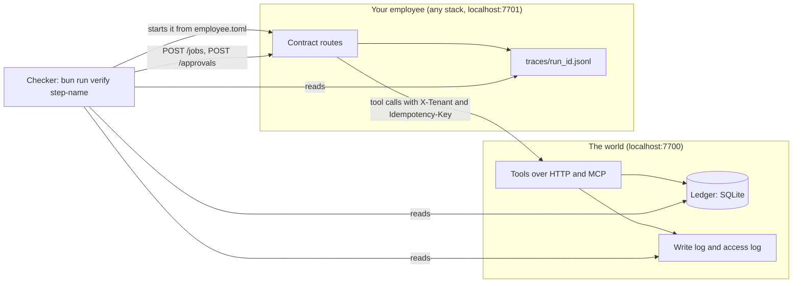

# The contract, version 1

Your employee and the checker talk through this contract and nothing else. Any language, SDK or model passes,
because the checker never imports your code. It sends jobs, plays the people, reads the ledger, reads the world's
logs and reads your traces. Your employee's reply is only a claim. The ledger decides.



## employee.toml

The checker reads this file to start your employee. It sits in the folder the check is pointed at.

```toml
[hire]
name = "freight-audit-clerk"
outcome = "Each carrier invoice is paid or disputed per the rate confirmation and the proof of delivery."
metric = "Cost per invoice settled: model spend divided by invoices the ledger shows settled."
must_never = "Pay an invoice twice, or pay above the rate confirmation without the finance lead's approval."
starts_by = ["person"]           # person, event, schedule or agent
lives = "one job"                # one job, one case, or always on

[contract]
version = "1"
mode = "http"                    # or "cli"
start = "bun start.ts"           # run from this folder; for mode = "cli" it is the command that takes the action
url = "http://localhost:7701"
traces = "traces"                # folder for traces/<run_id>.jsonl, relative to this file

[budget]
max_steps = 12
max_usd_per_job = 0.05
max_usd_per_day = 5
```

When the checker starts your employee it sets these environment variables. Use them when they are set.

| Variable | What it is |
|---|---|
| `PORT` | The port to answer the contract on. It overrides the port in `url`. |
| `WORLD_URL` | Where the world's tools are. Defaults to `http://localhost:7700`. |
| `TRACE_DIR` | Where to write traces. It overrides `traces`. |
| `STATE_DIR` | A fresh, empty folder for your saved state on each trial. Keep job progress here. |
| `MODEL_MODE` | `replay` in checks, so a recorded reply answers and no model key is needed, if your employee supports it. |

## The six routes

| Action | HTTP | Answer |
|---|---|---|
| Health | `GET /health` | `{"contract": "1", "employee": "freight-audit-clerk", "tenants": ["kaas-freight"]}` |
| Start a job | `POST /jobs` with `{"job_id", "tenant", "trigger": {"kind", "by"}, "input": {"invoice_id"}}` | `202 {"job_id", "run_id"}`. The same `job_id` again starts nothing new and answers the first `run_id` |
| Read a job | `GET /jobs/{job_id}` | `{"status", "reason", "cost_usd"}`. `status` is one of `working`, `waiting_for_human`, `done`, `declined`, `stopped`, `failed` |
| List approvals | `GET /approvals?status=waiting` | `[{"approval_id", "job_id", "action", "amount", "summary", "approver_role"}]` |
| Decide | `POST /approvals/{approval_id}` with `{"decision": "approve" or "decline", "by": "lena"}` | `200`, or `403 {"reason"}` when that person may not decide it |
| Board | `GET /board` | `{"tenants": [{"tenant", "outcomes", "spend_usd", "cost_per_outcome_usd", "by_employee": [...]}]}` |

`trigger.kind` is `person`, `event`, `schedule` or `agent`. The checker never trusts `status: done`. A `done` with
no ledger row fails the step and prints which invoice the ledger shows nothing for.

## The same six as CLI commands

Set `mode = "cli"`. The checker runs `start` with the action as its last argument, writes the request as JSON on
stdin and reads one JSON answer from stdout. Exit 0 for success; for a refusal print `{"status": 403, "reason"}`.

| Action | Command | stdin |
|---|---|---|
| Health | `<start> health` | `{}` |
| Start a job | `<start> start-job` | the job, as for `POST /jobs` |
| Read a job | `<start> read-job` | `{"job_id"}` |
| List approvals | `<start> list-approvals` | `{"status": "waiting"}` |
| Decide | `<start> decide` | `{"approval_id", "decision", "by"}` |
| Board | `<start> board` | `{}` |

A CLI employee keeps its jobs in `STATE_DIR`, since each command is a new process. `start-job` may run the job to
its end before it answers. The steps that kill a running employee need `mode = "http"`.

## The world's tools

`POST {WORLD_URL}/tools/<name>` with a JSON body, or MCP (JSON-RPC `tools/list` and `tools/call`) at
`{WORLD_URL}/mcp`. Every call sends `X-Tenant` (the job's tenant). Send `X-Employee` and `X-Job-Id` too: the world's
access log uses them. Write tools need an `Idempotency-Key` header (over MCP, an `idempotency_key` argument). The
same key with the same request answers the first result and writes nothing new.

| Tool | Kind | Takes |
|---|---|---|
| `find_load` | read | `load_id` |
| `read_invoice` | read | `invoice_id` |
| `read_rate_confirmation` | read | `load_id` |
| `read_proof_of_delivery` | read | `load_id` |
| `pay_invoice` | final write | `invoice_id`, `amount_usd`, `approved_by` (optional) |
| `open_dispute` | undoable write | `invoice_id`, `reason_code`, `amount_usd`, `note`, `approved_by` (optional) |
| `email_carrier` | undoable write | `carrier_id`, `subject`, `body` |

Reason codes: `DUPLICATE`, `ABOVE_RATE`, `DETENTION_UNSIGNED`, `FUEL_ABOVE_CONTRACT`, `OTHER`. The people and their
limits are at `GET {WORLD_URL}/people`.

## The trace format: employee.trace/v1

One JSON object per line in `<traces>/<run_id>.jsonl`. Each line is one span.

```json
{"format": "employee.trace/v1", "trace_id": "run-1a2b", "span_id": "s2", "parent_span_id": "s1",
 "name": "execute_tool", "start_time": "2026-11-16T10:00:01.000Z", "end_time": "2026-11-16T10:00:01.040Z",
 "status": "ok", "attributes": {"gen_ai.tool.name": "read_invoice", "gen_ai.tool.call.id": "c1", "x.side_effect": "none"}}
```

`name` is the operation: `invoke_agent` for a run of an agent (one root per job run), `chat` for a model call,
`execute_tool` for a tool call. Attributes use the OpenTelemetry GenAI names as they are:

| Attribute | On | Meaning |
|---|---|---|
| `gen_ai.agent.name` | `invoke_agent` | The employee, or a role inside it such as `checker` |
| `gen_ai.request.model` | `chat` | The model asked |
| `gen_ai.usage.input_tokens`, `gen_ai.usage.output_tokens` | `chat` | Tokens, as the provider counted them |
| `gen_ai.usage.cache_read.input_tokens` | `chat` | Input tokens read from the cache |
| `gen_ai.tool.name`, `gen_ai.tool.call.id` | `execute_tool` | The tool and this call |

OpenTelemetry has no names for jobs, cost, outcomes or approvals, so a small `x.` set adds them: `x.job.id`,
`x.tenant`, `x.trigger.kind`, `x.outcome` (on the root), `x.idempotency_key` and `x.side_effect` (`none` or
`write`, on a tool call), `x.approval.decision` and `x.approval.by`, `x.role` (`checker` on a checker span), and
`x.policy.rule` and `x.policy.decision` on a span named `x.policy_gate`. If you already export OpenTelemetry spans,
each one converts one to one. The GenAI names come from `open-telemetry/semantic-conventions-genai`, which has no
release yet; this file copies the names as they stand there.

Cost is never read from you. The checker computes it from the token counts and the dated price table in
`config/models.ts`, and it refuses a price table older than 60 days.
